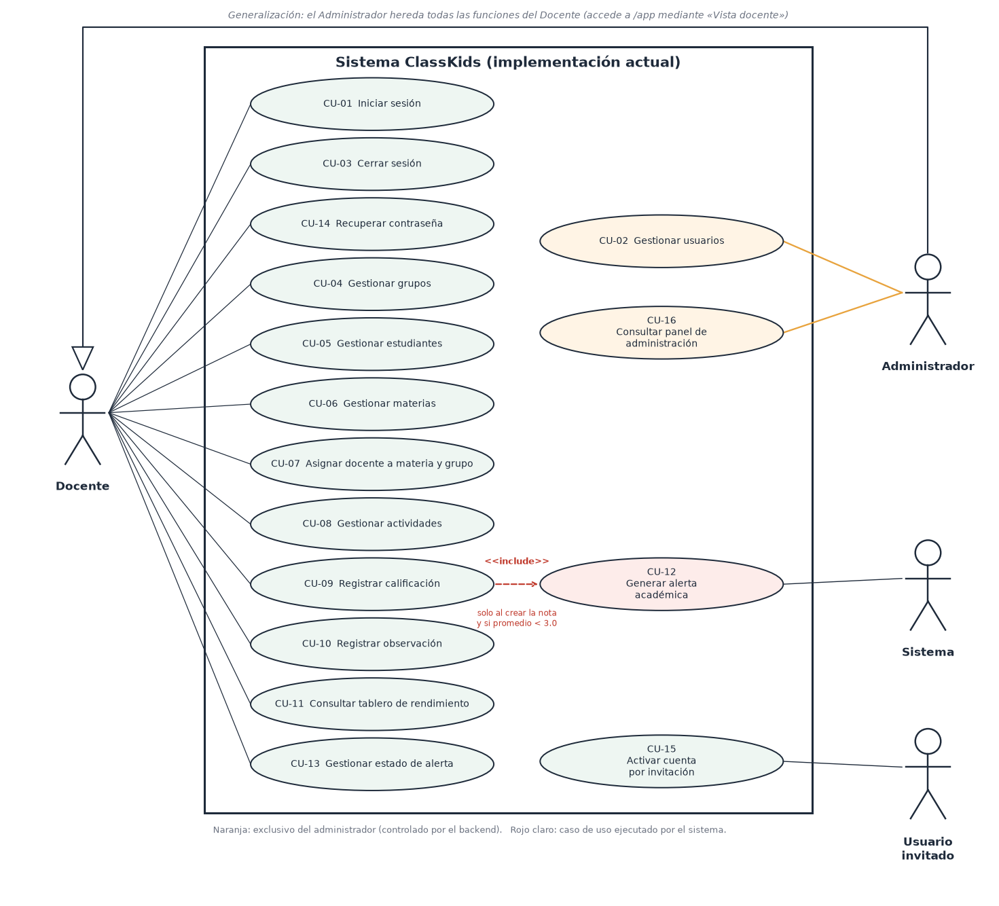

# Casos de uso

Este capítulo especifica los casos de uso de ClassKids tal como están implementados. Se conserva la numeración CU-01 a CU-13 del documento original (versión 1.0, noviembre de 2025), se completan los casos que no tenían especificación (CU-07) y se agregan tres casos para funcionalidades construidas después (CU-14 a CU-16). Cada especificación indica la pantalla y el endpoint que la implementan y su estado real.

## Diagrama de casos de uso

## Listado de casos de uso

| ID | Nombre | Actor principal | Módulo | Estado |
|---|---|---|---|---|
| CU-01 | Iniciar sesión | Docente, Administrador | Seguridad y acceso | Implementado |
| CU-02 | Gestionar usuarios | Administrador | Administración de usuarios | Parcial |
| CU-03 | Cerrar sesión | Docente, Administrador | Seguridad y acceso | Parcial |
| CU-04 | Gestionar grupos | Administrador (gestión), Docente (consulta) | Grupos | Parcial |
| CU-05 | Gestionar estudiantes | Docente, Administrador | Estudiantes | Parcial |
| CU-06 | Gestionar materias | Administrador (gestión), Docente (consulta) | Materias y asignaciones | Parcial |
| CU-07 | Asignar docente a materia y grupo | Administrador | Materias y asignaciones | Implementado |
| CU-08 | Gestionar actividades | Docente | Actividades | Parcial |
| CU-09 | Registrar calificación | Docente | Calificaciones | Implementado con observaciones |
| CU-10 | Registrar observación | Docente | Observaciones | Implementado |
| CU-11 | Consultar tablero de rendimiento | Docente | Análisis de rendimiento | Implementado con observaciones |
| CU-12 | Generar alerta académica | Sistema | Alertas académicas | Parcial |
| CU-13 | Gestionar estado de alerta | Docente | Alertas académicas | Implementado |
| CU-14 | Recuperar contraseña | Docente, Administrador | Seguridad y acceso | Implementado (requiere SMTP) |
| CU-15 | Activar cuenta por invitación | Usuario invitado | Seguridad y acceso | Implementado |
| CU-16 | Consultar panel de administración | Administrador | Administración de usuarios | Implementado |

**Criterio de estado.** *Implementado*: el flujo completo está disponible en la interfaz y persiste en la base de datos. *Parcial*: parte del flujo existe solo en la API o falta una operación que el caso de uso contempla. *Con observaciones*: funciona, pero tiene un comportamiento que debe corregirse (ver el capítulo de hallazgos).

## Correspondencia de numeraciones

Durante el proyecto circularon dos numeraciones. La siguiente tabla relaciona la lista resumida de diez casos de uso con la numeración oficial de este documento.

| Lista resumida | Numeración oficial (este documento) |
|---|---|
| CU-01 Iniciar sesión | CU-01 Iniciar sesión |
| CU-02 Gestionar usuarios | CU-02 Gestionar usuarios |
| CU-03 Cerrar sesión | CU-03 Cerrar sesión |
| CU-04 Nuevo grupo | CU-04 Gestionar grupos |
| CU-05 Nuevo estudiante | CU-05 Gestionar estudiantes |
| CU-06 Nueva actividad | CU-08 Gestionar actividades |
| CU-07 Registrar calificación | CU-09 Registrar calificación |
| CU-08 Registrar observación | CU-10 Registrar observación |
| CU-09 Consultar tablero de rendimiento general | CU-11 Consultar tablero de rendimiento |
| CU-10 Generar alerta académica | CU-12 Generar alerta académica |
| (no incluido) | CU-06, CU-07, CU-13, CU-14, CU-15, CU-16 |

## Datos comunes de las especificaciones

| Campo | Valor |
|---|---|
| Autores (versión 1.0) | Alejandra Guio, Andrés Gutiérrez, Johanna Ortiz (registro histórico; Andrés Gutiérrez ya no forma parte del equipo) |
| Fecha de creación | 04/11/2025 |
| Actualizado por (versión 2.0) | Equipo ClassKids (María Alejandra Guio, Faloon Johanna Ortiz, Jan Llanos) |
| Última actualización | 20/11/2026 |
| Versión | 2.0 |

## CU-01 Iniciar sesión

| Campo | Detalle |
|---|---|
| Descripción | Permite que un docente o administrador ingrese al sistema con su correo y contraseña. El sistema verifica que el usuario exista, que esté activo y que la contraseña coincida con el hash almacenado, y concede acceso según el rol. |
| Actores | Docente, Administrador |
| Precondiciones | El usuario está registrado y activo. El backend y la base de datos están en ejecución. |
| Postcondiciones | Se emite un token JWT con vigencia de 8 horas que se guarda en el navegador junto con los datos del usuario. Se actualiza la fecha de último ingreso (`last_sign_in_at`). |
| Frecuencia | Alta |
| Implementación | Pantalla `/auth` (`Auth.tsx`) · `POST /auth/login` |
| Estado | Implementado |

**Flujo normal**

| Paso | Actor | Sistema |
|---|---|---|
| 1 | El usuario accede a la pantalla de inicio de sesión. | Muestra el formulario con los campos Email y Contraseña. |
| 2 | Digita su correo y su contraseña. | Valida en el navegador el formato del correo y que la contraseña tenga al menos 6 caracteres. No permite copiar ni pegar la contraseña. |
| 3 | Pulsa «Iniciar sesión». | Envía las credenciales a `POST /auth/login`. |
| 4 | — | Busca el usuario por correo (sin distinguir mayúsculas), verifica que esté activo y compara la contraseña con el hash PBKDF2. |
| 5 | — | Registra la fecha de ingreso, genera el token con el rol del usuario y lo devuelve. |
| 6 | — | Guarda la sesión, muestra «¡Bienvenido a ClassKids!» y redirige al Dashboard. Si el usuario es administrador, la barra lateral muestra además «Panel Admin». |

**Flujos alternativos**

| Código | Condición | Comportamiento del sistema |
|---|---|---|
| A1 | El usuario pulsa «¿Olvidaste tu contraseña?». | Continúa en CU-14 Recuperar contraseña. |
| A2 | El usuario ya tiene una sesión activa y abre `/auth`. | Lo redirige directamente al Dashboard. |

**Flujos excepcionales**

| Código | Condición | Comportamiento del sistema |
|---|---|---|
| E1 | El correo no existe o la contraseña es incorrecta. | Responde 401 y muestra «Correo o contraseña incorrectos» (el mismo mensaje en ambos casos). |
| E2 | La cuenta está desactivada. | Responde 403 y muestra «Esta cuenta se encuentra deshabilitada. Contacte al administrador.» |
| E3 | Un campo está vacío. | El navegador impide el envío del formulario. |

## CU-02 Gestionar usuarios

| Campo | Detalle |
|---|---|
| Descripción | Permite al administrador incorporar usuarios mediante invitación, cambiar el rol de un usuario y desactivar cuentas. |
| Actores | Administrador |
| Precondiciones | El administrador inició sesión. |
| Postcondiciones | Queda registrada una invitación con vigencia de 48 horas, o el usuario queda con un nuevo rol, o queda desactivado (baja lógica). |
| Frecuencia | Media |
| Implementación | Pantalla `/admin/usuarios` (`AdminUsuarios.tsx`) · `GET /usuarios`, `POST /usuarios/invitar`, `PUT /usuarios/{id}/rol`, `DELETE /usuarios/{id}` |
| Estado | Parcial: no se pueden editar el nombre ni el correo, ni reactivar o listar usuarios desactivados. |

**Flujo normal (invitar usuario)**

| Paso | Actor | Sistema |
|---|---|---|
| 1 | Ingresa a Panel Admin → Usuarios. | Lista los usuarios activos con nombre, correo, rol, última conexión y fecha de creación. |
| 2 | Pulsa «Invitar docente». | Muestra el formulario con Correo electrónico y Rol (Docente o Administrador). |
| 3 | Ingresa el correo, elige el rol y pulsa «Enviar invitación». | Verifica que no exista un usuario activo con ese correo y registra la invitación con un token único. |
| 4 | — | Si hay servidor SMTP configurado, envía el correo de invitación. En todos los casos muestra el «Enlace de prueba» para copiarlo y actualiza la lista. |

**Flujos alternativos**

| Código | Condición | Comportamiento del sistema |
|---|---|---|
| A1 | Cambia el rol de un usuario en su fila. | Actualiza el rol y muestra «Rol actualizado». |
| A2 | Pulsa el ícono de eliminar y confirma. | Desactiva la cuenta (`activo = false`), muestra «Usuario eliminado» y la retira de la lista. El usuario ya no puede iniciar sesión. |
| A3 | Pulsa «Cancelar». | Cierra el formulario sin guardar. |
| A4 | Intenta modificar su propia cuenta. | La interfaz marca la fila propia como «(tú)» y deshabilita el cambio de rol y la desactivación de la propia cuenta. El backend todavía no lo impide si se llama a la API directamente (hallazgo H-18, corregido en la interfaz el 24/11/2026). |

**Flujos excepcionales**

| Código | Condición | Comportamiento del sistema |
|---|---|---|
| E1 | El correo ya pertenece a un usuario activo. | Responde 409 y muestra «El usuario ya existe». |
| E2 | Un docente intenta acceder. | El frontend lo redirige a `/app`; el backend responde 403 «Permisos insuficientes». |

## CU-03 Cerrar sesión

| Campo | Detalle |
|---|---|
| Descripción | Permite al usuario finalizar su sesión en el navegador. |
| Actores | Docente, Administrador |
| Precondiciones | El usuario inició sesión. |
| Postcondiciones | El token y los datos del usuario se eliminan del navegador y las rutas protegidas redirigen a la pantalla de inicio de sesión. |
| Frecuencia | Alta |
| Implementación | Botón «Cerrar sesión» de la barra lateral (`AppSidebar.tsx`, `AdminLayout.tsx`) · función `signOut()` de `AuthContext` |
| Estado | Parcial: el cierre ocurre solo en el navegador; el token no se invalida en el servidor y sigue siendo válido hasta su vencimiento (8 horas). No hay cierre automático por inactividad. |

**Flujo normal**

| Paso | Actor | Sistema |
|---|---|---|
| 1 | Pulsa «Cerrar sesión» en la barra lateral. | Elimina el token y los datos del usuario del almacenamiento local. |
| 2 | — | Redirige a la pantalla de inicio de sesión al intentar acceder a cualquier ruta protegida. |

**Flujos alternativos y excepcionales:** no aplica. El sistema no solicita confirmación para cerrar la sesión.

## CU-04 Gestionar grupos

| Campo | Detalle |
|---|---|
| Descripción | Permite crear grupos académicos y consultarlos con sus indicadores: número de estudiantes y de actividades, promedio del grupo, alertas abiertas y nivel de rendimiento. |
| Actores | Administrador (crea grupos y ve todos); Docente (consulta solo los grupos donde tiene materias asignadas) |
| Precondiciones | El usuario inició sesión. Para el docente: tener al menos una asignación. |
| Postcondiciones | El grupo queda registrado con año lectivo 2026 y aparece en el listado. |
| Frecuencia | Baja |
| Implementación | Pantalla `/app/grupos` (`Grupos.tsx`) · `GET /grupos`, `POST /grupos`. La API también ofrece `PUT /grupos/{id}` y `DELETE /grupos/{id}`. |
| Estado | Parcial: la interfaz no permite editar ni eliminar grupos; los botones «⋮» y «Ver detalle del grupo» no tienen acción asociada. |

**Flujo normal**

| Paso | Actor | Sistema |
|---|---|---|
| 1 | Selecciona «Grupos». | Muestra tres indicadores (grupos, estudiantes totales y promedio global) y una tarjeta por grupo. |
| 2 | Opcionalmente busca por nombre o filtra por grado y turno. | Actualiza el listado. |
| 3 | (Administrador) Pulsa «Nuevo Grupo». | Muestra el formulario con Curso (1.°A a 5.°B) y Turno (Matutino o Vespertino). |
| 4 | Selecciona curso y turno y pulsa «Crear grupo». | Registra el grupo, muestra «Grupo creado» y actualiza el listado. |

**Flujos alternativos**

| Código | Condición | Comportamiento del sistema |
|---|---|---|
| A1 | Pulsa «Cancelar». | Cierra el formulario sin guardar. |

**Flujos excepcionales**

| Código | Condición | Comportamiento del sistema |
|---|---|---|
| E1 | No selecciona curso o turno. | Muestra «Completa todos los campos». |
| E2 | Falla el registro. | Muestra «Error al crear grupo». |
| E3 | Se elimina por API un grupo con actividades. | Responde 409: «No se puede eliminar el grupo: tiene actividades u otros registros asociados». |
| EP | Un docente intenta crear, editar o eliminar un grupo (incluso por API). | Responde 403 «Solo el administrador puede realizar esta acción». El botón «Nuevo Grupo» solo se muestra al administrador. |

## CU-05 Gestionar estudiantes

| Campo | Detalle |
|---|---|
| Descripción | Permite registrar estudiantes asociados a un grupo, editarlos, buscarlos, filtrarlos y consultar su detalle académico. |
| Actores | Docente (estudiantes de sus grupos) y Administrador (todos) |
| Precondiciones | El usuario inició sesión y existe al menos un grupo de su ámbito. |
| Postcondiciones | El estudiante queda registrado o actualizado y vinculado a su grupo. |
| Frecuencia | Alta |
| Implementación | Pantalla `/app/estudiantes` (`Estudiantes.tsx`) · `GET /estudiantes`, `POST /estudiantes`, `PUT /estudiantes/{id}`. La API también ofrece `DELETE /estudiantes/{id}`. |
| Estado | Parcial: la interfaz no permite eliminar ni desactivar estudiantes. |

**Flujo normal**

| Paso | Actor | Sistema |
|---|---|---|
| 1 | Selecciona «Estudiantes». | Muestra los indicadores (total, en riesgo o crítico, promedio general) y la tabla con estudiante, grupo, promedio, tendencia, estado y alertas. |
| 2 | Pulsa «Nuevo Estudiante». | Muestra el formulario con Documento, Nombre, Apellido y Grupo. |
| 3 | Completa los datos y pulsa «Registrar». | Registra el estudiante, muestra «Estudiante registrado» y actualiza la tabla. |

**Flujos alternativos**

| Código | Condición | Comportamiento del sistema |
|---|---|---|
| A1 | Busca por nombre o filtra por grupo o estado. | Actualiza la tabla; los filtros se pueden combinar. La búsqueda también se puede iniciar desde el Dashboard. |
| A2 | Hace clic en un estudiante. | Muestra el detalle: promedio, estado, tendencia, alertas activas y observaciones (CU-10). |
| A3 | En el detalle pulsa «Editar», modifica los datos y pulsa «Guardar cambios». | El formulario muestra los datos actuales, incluido el grupo. Actualiza el estudiante, conserva su estado activo o inactivo y muestra «Estudiante actualizado». |
| A4 | Pulsa «Cancelar». | Cierra el formulario sin guardar. |

**Flujos excepcionales**

| Código | Condición | Comportamiento del sistema |
|---|---|---|
| E1 | Falta algún campo. | Muestra «Completa todos los campos». |
| E2 | El documento ya existe. | La base de datos rechaza el registro; el servidor responde con error 500 y la interfaz muestra «Error al registrar estudiante». |
| EP | Un docente consulta o registra estudiantes de un grupo que no es suyo, o intenta eliminar un estudiante. | Responde 403 y no modifica datos; eliminar estudiantes es del administrador (RN-30, RN-33). |

## CU-06 Gestionar materias

| Campo | Detalle |
|---|---|
| Descripción | Permite administrar el catálogo de materias de la institución. |
| Actores | Administrador (gestiona el catálogo); Docente (consulta sus materias asignadas) |
| Precondiciones | El usuario inició sesión. |
| Postcondiciones | La materia queda registrada o eliminada. |
| Frecuencia | Baja |
| Implementación | Pantalla `/app/materias`, pestaña «Catálogo de Materias» (`Materias.tsx`) · `GET /materias`, `POST /materias`, `DELETE /materias/{id}`. La API también ofrece `PUT /materias/{id}`. |
| Estado | Parcial: la interfaz no permite editar el nombre ni registrar el código de la materia. |

**Flujo normal**

| Paso | Actor | Sistema |
|---|---|---|
| 1 | Selecciona «Materias». | Al administrador le muestra materias totales, asignaciones activas y grupos sin asignar; al docente, sus materias, sus asignaciones y sus grupos. Debajo, el catálogo con buscador. |
| 2 | (Administrador) Pulsa «Nueva Materia», escribe el nombre y pulsa «Crear Materia». | Registra la materia y muestra «¡Materia creada con éxito!». |

**Flujos alternativos**

| Código | Condición | Comportamiento del sistema |
|---|---|---|
| A1 | (Administrador) Pulsa el ícono de eliminar de una materia. | Pide confirmación en un diálogo; al confirmar, elimina la materia y muestra «Materia eliminada» (H-39). |

**Flujos excepcionales**

| Código | Condición | Comportamiento del sistema |
|---|---|---|
| E1 | El nombre está vacío. | Muestra «Ingresa el nombre de la materia». |
| E2 | La materia tiene actividades, calificaciones o asignaciones. | Responde 409 y la interfaz muestra «Error al eliminar la materia». |
| EP | Un docente intenta crear, editar o eliminar una materia (incluso por API). | Responde 403. La interfaz del docente no muestra «Nueva Materia», «Vincular a Grupo» ni los botones de eliminar. |

## CU-07 Asignar docente a materia y grupo

| Campo | Detalle |
|---|---|
| Descripción | Define qué docente es responsable de cada materia en cada grupo. Solo puede existir un docente por materia en un mismo grupo. |
| Actores | Administrador (según el diseño). En la implementación actual también está disponible para el docente. |
| Precondiciones | Existen materias, grupos y al menos un docente activo. |
| Postcondiciones | La asignación queda registrada y se muestra en la vista por grupos. |
| Frecuencia | Baja |
| Implementación | Pantalla `/app/materias`, pestaña «Vista por Grupos» (`Materias.tsx`) · `GET /asignaciones`, `POST /asignaciones`, `DELETE /asignaciones/{id}`, `GET /catalogo/docentes` |
| Estado | Implementado |

**Flujo normal**

| Paso | Actor | Sistema |
|---|---|---|
| 1 | Abre la pestaña «Vista por Grupos». | Muestra cada grupo con sus materias y el docente asignado. |
| 2 | Pulsa «Vincular a Grupo». | Muestra el formulario con Docente (solo docentes activos), Materia y Grupo. |
| 3 | Selecciona los tres datos y pulsa «Vincular». | Verifica que el docente exista y que la materia no tenga docente en ese grupo; registra la asignación y muestra «¡Asignación vinculada!». |

**Flujos alternativos**

| Código | Condición | Comportamiento del sistema |
|---|---|---|
| A1 | Pulsa el ícono de desvincular en una asignación. | Elimina la asignación y muestra «Asignación desvinculada». |

**Flujos excepcionales**

| Código | Condición | Comportamiento del sistema |
|---|---|---|
| E1 | Falta seleccionar algún dato. | Muestra «Selecciona docente, materia y grupo». |
| E2 | La materia ya tiene docente en ese grupo. | Muestra «Esta asignación ya existe para este grupo» (la API responde 409). |
| E3 | El docente no existe o está inactivo. | Responde 404 «Docente no encontrado». |
| EP | Un docente intenta crear o eliminar una asignación, o consultar el catálogo de docentes. | Responde 403. El docente solo consulta sus propias asignaciones (`GET /asignaciones`). |

## CU-08 Gestionar actividades

| Campo | Detalle |
|---|---|
| Descripción | Permite crear actividades académicas (tarea, examen, proyecto o participación) asociadas a una materia y a un grupo, y consultarlas con su estado y progreso de entrega. |
| Actores | Docente (actividades de sus materias en sus grupos) y Administrador |
| Precondiciones | El usuario inició sesión y tiene asignada la materia en el grupo de la actividad. |
| Postcondiciones | La actividad queda registrada y disponible para registrar calificaciones. |
| Frecuencia | Alta |
| Implementación | Pantalla `/app/actividades` (`Actividades.tsx`) · `GET /actividades`, `POST /actividades`. La API también ofrece `PUT` y `DELETE /actividades/{id}`. |
| Estado | Parcial: la interfaz no permite editar ni eliminar actividades. |

**Flujo normal**

| Paso | Actor | Sistema |
|---|---|---|
| 1 | Selecciona «Actividades». | Tras unos 5 segundos (H-16, pendiente) muestra cuatro indicadores (total, completadas, pendientes y vencidas) y una tarjeta por actividad con tipo, grupo, fecha de entrega, entregas (estudiantes distintos con la entrega registrada), progreso, estado y promedio. |
| 2 | Opcionalmente busca o filtra por tipo, estado o grupo. | Actualiza el listado. |
| 3 | Pulsa «Nueva Actividad». | Muestra el formulario con Título, Tipo, Grupo, Fecha de entrega, Materia y Descripción (opcional). |
| 4 | Completa los datos y pulsa «Crear actividad». | Registra la actividad, muestra «Actividad creada» y actualiza el listado. |

**Flujos alternativos**

| Código | Condición | Comportamiento del sistema |
|---|---|---|
| A1 | Pulsa «Cancelar». | Cierra el formulario sin guardar. |

**Flujos excepcionales**

| Código | Condición | Comportamiento del sistema |
|---|---|---|
| E1 | Falta un campo requerido. | Muestra «Completa los campos requeridos». |
| E2 | La fecha de entrega es anterior a hoy. | El sistema la acepta; la actividad aparece como «Vencida». |
| EP | Un docente intenta crear, editar o eliminar una actividad de una materia o grupo que no tiene asignados. | Responde 403 «No tienes asignada esta materia en ese grupo». El formulario solo ofrece las materias del docente en el grupo elegido. |

## CU-09 Registrar calificación

| Campo | Detalle |
|---|---|
| Descripción | Permite registrar o actualizar en una sola operación las calificaciones de todos los estudiantes de un grupo en una actividad. Las calificaciones se almacenan en la escala oficial de 0.0 a 5.0; la pantalla las registra y muestra en esa misma escala, con su equivalencia en porcentaje como dato secundario (ver «Ciclo de una calificación» en el capítulo de reglas de negocio). |
| Actores | Docente (estudiantes de un grupo donde dicta esa materia) y Administrador |
| Precondiciones | El usuario inició sesión y tiene asignada la materia de la actividad en el grupo del estudiante. |
| Postcondiciones | Solo las calificaciones que el docente creó o modificó quedan guardadas; las nuevas en el periodo 1, las editadas conservan su periodo y su observación. Al crear una calificación, el sistema evalúa la regla de alerta (CU-12). |
| Frecuencia | Muy alta |
| Implementación | Pantalla `/app/calificaciones` (`Calificaciones.tsx`) · `GET /calificaciones`, `POST /calificaciones`, `PUT /calificaciones/{id}` |
| Estado | Implementado con observaciones: H-02, H-31 y H-33 corregidos; H-05 (validación en el backend) corregido el 24/11/2026; siguen pendientes H-03 (precisión) y H-19 (promedio con vacíos). En la base real, «Entregado» persiste solo tras la migración 001. |

**Flujo normal**

| Paso | Actor | Sistema |
|---|---|---|
| 1 | Selecciona «Calificaciones» y elige un grupo. | Carga las actividades del grupo. |
| 2 | Elige una actividad. | Muestra los estudiantes del grupo ordenados por apellido, con su nota actual en la escala 0.0–5.0 (campo vacío si no tiene), el interruptor «Entregado» leído de la base de datos y el estado: Excelente (≥ 4.5), Aprobado (≥ 3.5), Reprobado (> 0) o Sin calificar, con las equivalencias junto a cada nota (por ejemplo «86 % · 17.2 / 20» para 4.3). Muestra cuatro indicadores: estudiantes, entregados, aprobados (≥ 3.5) y promedio. El botón «Guardar cambios» está desactivado mientras no haya cambios. |
| 3 | Escribe las notas de 0.0 a 5.0 (con punto o coma decimal) y marca «Entregado» cuando corresponda. | Resalta las filas modificadas y muestra su número en el botón: «Guardar cambios (n)». Un valor fuera de 0.0–5.0 o con más de un decimal se marca en rojo con el motivo y desactiva el botón hasta corregirlo. |
| 4 | Pulsa «Guardar cambios (n)». | Solo para las filas modificadas convierte el porcentaje a la escala oficial (÷ 20, con un decimal; por ejemplo, 86 → 4.3) y crea la calificación (`POST`, periodo 1) o la actualiza (`PUT`, solo nota y entrega). La observación y el periodo existentes se conservan. |
| 5 | — | Al crear cada calificación ejecuta CU-12. Muestra «Calificaciones guardadas correctamente (n)» y recarga la tabla. |

**Flujos alternativos**

| Código | Condición | Comportamiento del sistema |
|---|---|---|
| A1 | El estudiante ya tenía nota en esa actividad. | Actualiza la nota existente. En una actualización no se evalúa la regla de alerta. |

**Flujos excepcionales**

| Código | Condición | Comportamiento del sistema |
|---|---|---|
| E1 | Falla el guardado de alguna fila. | Muestra «Error al guardar calificaciones» con el motivo devuelto por el servidor e indica cuántas filas se guardaron antes del error. |
| E3 | Marca «Entregado» a un estudiante sin nota y no le asigna calificación. | No guarda esa fila e informa que debe ingresar la calificación. |
| E2 | Se envía por API una nota fuera del rango 0–5. | La base de datos la rechaza y el servidor responde con error 500. |
| EP | Un docente intenta registrar, editar o eliminar una nota de otra materia o de un estudiante de otro grupo, o consultar las notas de una actividad ajena. | Responde 403 y no guarda la nota (RN-35). |

## CU-10 Registrar observación

| Campo | Detalle |
|---|---|
| Descripción | Permite registrar observaciones cualitativas sobre un estudiante, clasificadas como Académica, Convivencial o Reconocimiento, con fecha y hora automáticas. |
| Actores | Docente (estudiantes de sus grupos) y Administrador |
| Precondiciones | El usuario inició sesión y el estudiante pertenece a uno de sus grupos. |
| Postcondiciones | La observación queda registrada y visible en el detalle del estudiante. |
| Frecuencia | Media |
| Implementación | Detalle del estudiante en `/app/estudiantes` (`ObservacionesEstudiante.tsx`) · `GET /observaciones`, `POST /observaciones`, `DELETE /observaciones/{id}` |
| Estado | Implementado (sin autor de la observación ni edición). |

**Flujo normal**

| Paso | Actor | Sistema |
|---|---|---|
| 1 | Abre el detalle de un estudiante. | Muestra la sección Observaciones con el historial (tipo, fecha y hora, descripción). |
| 2 | Pulsa «Nueva». | Muestra el selector de tipo (por defecto Convivencial) y el campo de texto. |
| 3 | Elige el tipo, escribe la observación y pulsa «Guardar». | Registra la observación y muestra «Observación registrada». |

**Flujos alternativos**

| Código | Condición | Comportamiento del sistema |
|---|---|---|
| A1 | Pulsa eliminar en una observación. | La elimina y muestra «Observación eliminada». |
| A2 | Pulsa «Cancelar». | Oculta el formulario sin guardar. |

**Flujos excepcionales**

| Código | Condición | Comportamiento del sistema |
|---|---|---|
| E1 | La descripción está vacía. | Muestra «Escribe una observación». |
| EP | Un docente intenta registrar o eliminar una observación de un estudiante de otro grupo. | Responde 403 «Este estudiante no pertenece a tus grupos». |

## CU-11 Consultar tablero de rendimiento

| Campo | Detalle |
|---|---|
| Descripción | Permite consultar de forma consolidada el rendimiento académico mediante el Dashboard del docente y la pantalla Análisis. Los indicadores se calculan en el navegador a partir de los datos reales de la API. |
| Actores | Docente (indicadores de sus asignaciones) y Administrador (visión general) |
| Precondiciones | El usuario inició sesión. |
| Postcondiciones | El usuario visualiza los indicadores actualizados. |
| Frecuencia | Alta |
| Implementación | Pantallas `/app` (`Dashboard.tsx` y componentes `dashboard/*`) y `/app/analisis` (`Analisis.tsx`) |
| Estado | Implementado con observaciones: no tiene filtros por grupo, materia o periodo, y la etiqueta del mes en la tendencia es incorrecta (hallazgo H-07). |

**Flujo normal**

| Paso | Actor | Sistema |
|---|---|---|
| 1 | Ingresa al Dashboard. | Muestra el saludo, el buscador de estudiantes, accesos rápidos, cuatro tarjetas (grupos, estudiantes, actividades, alertas), la gráfica de rendimiento por materia, el panel de alertas tempranas (solo alertas activas, con el enlace «Ver alertas resueltas») y una lista de estudiantes con su estado. Los totales de estudiantes y alertas usan los mismos criterios que el panel de administración. |
| 2 | Selecciona «Análisis». | Muestra cuatro indicadores (promedio general, estudiantes, estudiantes en riesgo y variación frente al mes anterior), las gráficas de rendimiento por grupo, distribución de rendimiento, tendencia mensual y rendimiento por tipo de actividad, y la tabla de estudiantes en riesgo. |
| 3 | Revisa la información. | Clasifica a cada estudiante como Crítico (< 60 %) o En riesgo (60–69 %) y muestra su tendencia. |

**Flujos excepcionales**

| Código | Condición | Comportamiento del sistema |
|---|---|---|
| E1 | No hay datos. | Las gráficas se muestran vacías. |
| E2 | Falla la carga. | Muestra «Error al cargar los datos de análisis». |
| EP | El docente solo tiene una materia. | Los indicadores se calculan solo con esa materia; Análisis no muestra el filtro «Materia» porque no hay otras. |

## CU-12 Generar alerta académica

| Campo | Detalle |
|---|---|
| Descripción | El sistema genera automáticamente una alerta de bajo rendimiento cuando, al registrar una nueva calificación, el promedio acumulado del estudiante es menor a 3.0. |
| Actores | Sistema |
| Precondiciones | Se crea una calificación nueva (CU-09). |
| Postcondiciones | Queda registrada una alerta de tipo `low_grade` en estado `active`, visible en Alertas y en el Dashboard. |
| Frecuencia | Alta |
| Implementación | Lógica de `POST /calificaciones` en `backend/main.py`. Creación manual disponible solo en la API: `POST /alertas`. |
| Estado | Parcial: solo existe la regla por promedio bajo; no hay reglas de inasistencia, comportamiento o deserción, y no hay pantalla para crear alertas manualmente. |

**Flujo normal**

| Paso | Actor | Sistema |
|---|---|---|
| 1 | — | Guarda la nueva calificación. |
| 2 | — | Calcula el promedio de todas las calificaciones del estudiante (todas las materias y periodos). |
| 3 | — | Si el promedio es menor a 3.0, verifica que el estudiante no tenga ya una alerta de bajo rendimiento abierta: de tipo `low_grade` o «Bajo Rendimiento», en estado activo o en revisión (decisión D3). |
| 4 | — | Registra la alerta con el mensaje «Promedio académico bajo: X.XX». |

**Flujos alternativos**

| Código | Condición | Comportamiento del sistema |
|---|---|---|
| A1 | El promedio es mayor o igual a 3.0, o ya existe una alerta de bajo rendimiento activa o en revisión. | No genera alerta. Si la alerta anterior está resuelta, sí se genera una nueva. |
| A2 | Se registra una alerta manual por API (`POST /alertas`). | Normaliza el estado (`active`, `reviewed` o `resolved`) y la registra. |

**Flujos excepcionales**

| Código | Condición | Comportamiento del sistema |
|---|---|---|
| E1 | Se envía por API un estado de alerta no reconocido. | Responde 422 «Estado de alerta inválido». |

## CU-13 Gestionar estado de alerta

| Campo | Detalle |
|---|---|
| Descripción | Permite consultar las alertas con filtros y cambiar su estado de seguimiento: Activa, En revisión o Resuelta. |
| Actores | Docente (alertas de su ámbito, RN-37) y Administrador |
| Precondiciones | El usuario inició sesión y la alerta es visible para él. |
| Postcondiciones | La alerta queda con el nuevo estado. |
| Frecuencia | Media |
| Implementación | Pantalla `/app/alertas` (`Alertas.tsx`) · `GET /alertas`, `PUT /alertas/{id}/estado` |
| Estado | Implementado |

**Flujo normal**

| Paso | Actor | Sistema |
|---|---|---|
| 1 | Selecciona «Alertas». | Muestra los contadores (activas, en revisión, resueltas) y la lista con estudiante, estado, prioridad, mensaje y antigüedad. |
| 2 | Opcionalmente filtra por tipo o estado. | Actualiza la lista. |
| 3 | Hace clic en una alerta. | Muestra el detalle de la alerta. |
| 4 | Pulsa «Marcar como revisada» o «Resolver». | Actualiza el estado y muestra «Alerta actualizada». |

**Flujos alternativos**

| Código | Condición | Comportamiento del sistema |
|---|---|---|
| A1 | La alerta ya está resuelta. | No muestra botones de cambio de estado (no se puede reabrir desde la interfaz). |
| A2 | Llega desde el enlace «Ver alertas resueltas» del Dashboard. | Abre la pantalla con el filtro «Resueltas» ya aplicado (historial de alertas resueltas, que se conservan en la base de datos). |

**Flujos excepcionales**

| Código | Condición | Comportamiento del sistema |
|---|---|---|
| E1 | Falla la actualización. | Muestra el mensaje de error devuelto por el servidor. |
| EP | Un docente intenta cambiar el estado de una alerta que no corresponde a sus asignaciones. | Responde 403 «Esta alerta no corresponde a tus asignaciones». |

## CU-14 Recuperar contraseña

| Campo | Detalle |
|---|---|
| Descripción | Permite a un usuario activo definir una nueva contraseña mediante un enlace enviado a su correo. |
| Actores | Docente, Administrador |
| Precondiciones | El usuario está registrado y activo. Para recibir el enlace, el backend debe tener configurado un servidor SMTP. |
| Postcondiciones | La contraseña queda actualizada y el enlace no se puede volver a usar. |
| Frecuencia | Baja |
| Implementación | Pantallas `/auth` (formulario de recuperación) y `/reset-password` (`ResetPassword.tsx`) · `POST /auth/forgot-password`, `POST /auth/reset-password` |
| Estado | Implementado. Sin SMTP configurado el enlace no llega al usuario. |

**Flujo normal**

| Paso | Actor | Sistema |
|---|---|---|
| 1 | En el inicio de sesión pulsa «¿Olvidaste tu contraseña?». | Muestra el formulario «Restablecer contraseña». |
| 2 | Escribe su correo y pulsa «Enviar enlace». | Si el correo pertenece a un usuario activo, genera un token con vigencia de 30 minutos y envía el enlace por correo. Siempre responde con un mensaje genérico. |
| 3 | — | Muestra «Revisa tu correo para restablecer tu contraseña». |
| 4 | Abre el enlace recibido. | Muestra el formulario «Nueva contraseña» con confirmación. |
| 5 | Escribe y confirma la nueva contraseña y la envía. | Valida el token, actualiza la contraseña, marca el token como usado y muestra «¡Contraseña actualizada con éxito!». |

**Flujos excepcionales**

| Código | Condición | Comportamiento del sistema |
|---|---|---|
| E1 | Las contraseñas no coinciden. | Muestra «Las contraseñas no coinciden». |
| E2 | La contraseña tiene menos de 6 caracteres. | Muestra «La contraseña debe tener al menos 6 caracteres». |
| E3 | El enlace venció, ya se usó o es inválido. | Muestra «Enlace de recuperación inválido o expirado». |

## CU-15 Activar cuenta por invitación

| Campo | Detalle |
|---|---|
| Descripción | Permite que una persona invitada por el administrador cree su cuenta definiendo nombre, apellido y contraseña. |
| Actores | Usuario invitado |
| Precondiciones | Existe una invitación vigente (48 horas) y no aceptada. |
| Postcondiciones | El usuario queda creado y activo con el rol de la invitación (si existía desactivado, se reactiva) y la invitación queda marcada como aceptada. |
| Frecuencia | Baja |
| Implementación | Pantalla `/invitacion?token=…` (`Invitation.tsx`) · `GET /invitaciones/{token}`, `POST /invitaciones/{token}/aceptar` |
| Estado | Implementado |

**Flujo normal**

| Paso | Actor | Sistema |
|---|---|---|
| 1 | Abre el enlace de invitación. | Valida la invitación y muestra «Activa tu cuenta» con el correo invitado. |
| 2 | Completa Nombres, Apellidos, Contraseña y Confirmar contraseña y envía el formulario. | Crea el usuario con la contraseña cifrada y marca la invitación como aceptada. |
| 3 | — | Muestra «Cuenta activada. Ya puedes iniciar sesión.» |

**Flujos excepcionales**

| Código | Condición | Comportamiento del sistema |
|---|---|---|
| E1 | La invitación venció, ya fue aceptada o no existe. | Muestra «La invitación es inválida o expiró» y el botón «Volver al inicio de sesión». |
| E2 | Las contraseñas no coinciden o tienen menos de 6 caracteres. | Muestra el mensaje de validación correspondiente. |

## CU-16 Consultar panel de administración

| Campo | Detalle |
|---|---|
| Descripción | Permite al administrador consultar las métricas globales de la plataforma y una vista de solo lectura de grupos, estudiantes y alertas. |
| Actores | Administrador |
| Precondiciones | El administrador inició sesión. |
| Postcondiciones | No modifica datos. |
| Frecuencia | Media |
| Implementación | Pantallas `/admin` (`AdminDashboard.tsx`) y `/admin/datos` (`AdminDatos.tsx`) · `GET /docentes/count`, `/admins/count`, `/grupos/count`, `/estudiantes/count`, `/actividades/count`, `/alertas/activas/count` |
| Estado | Implementado (H-25 y H-26 corregidos). |

**Flujo normal**

| Paso | Actor | Sistema |
|---|---|---|
| 1 | Pulsa «Panel Admin» en la barra lateral. | Muestra seis métricas (docentes, administradores, grupos, estudiantes, actividades y alertas activas) y una guía del proceso de creación de usuarios. |
| 2 | Selecciona «Datos globales». | Muestra las pestañas Grupos (nombre, grado, turno y año lectivo), Estudiantes y Alertas (con el estado en español) con los registros de toda la plataforma. |
| 3 | Pulsa «Gestión académica». | Abre los módulos académicos (`/app`) con la información de todo el colegio. |
