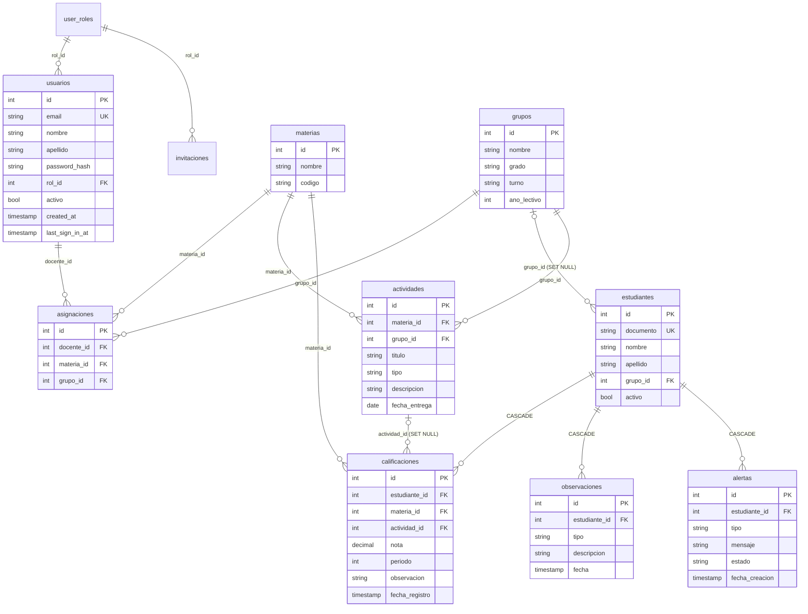
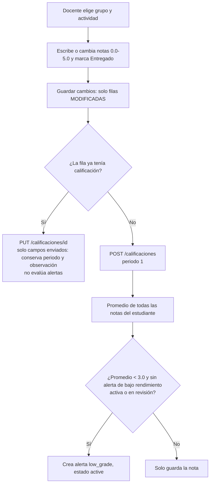

# Diagramas

Los diagramas se generaron el 20/11/2026 a partir de la estructura real de la base de datos (catálogo de PostgreSQL) y del código. Las imágenes PNG se incluyen en el documento Word y en los capítulos de `Docs/`. Debajo de la tabla se incluyen versiones en Mermaid, que GitHub muestra directamente y se pueden editar.

| Diagrama | Archivo | Capítulo |
|---|---|---|
| Casos de uso | [`casos-de-uso.png`](casos-de-uso.png) | [Casos de uso](../conceptos/casos-de-uso.md) |
| Modelo entidad-relación | [`mer-classkids.png`](mer-classkids.png) | [Modelo de datos](../referencia-tecnica/database-schema.md) |
| Arquitectura | [`arquitectura.png`](arquitectura.png) | [Arquitectura](../referencia-tecnica/architecture.md) |
| Flujo general del proceso | [`flujo-proceso.png`](flujo-proceso.png) | [Flujos](../referencia-tecnica/flujos.md) |
| Registro de calificaciones y alerta | [`flujo-calificacion-alerta.png`](flujo-calificacion-alerta.png) | [Flujos](../referencia-tecnica/flujos.md) |

## Modelo entidad-relación (Mermaid)

## Registro de calificación y alerta (Mermaid)

