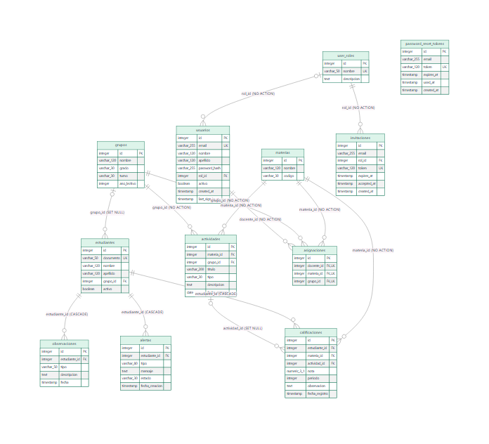
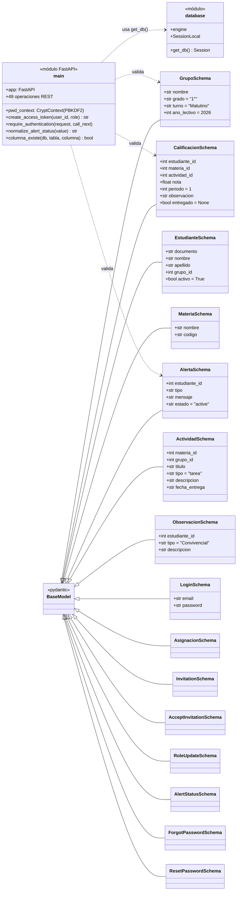
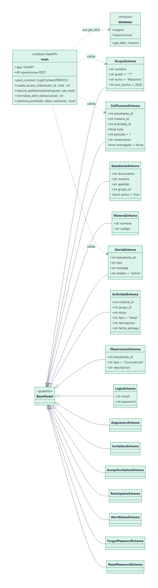
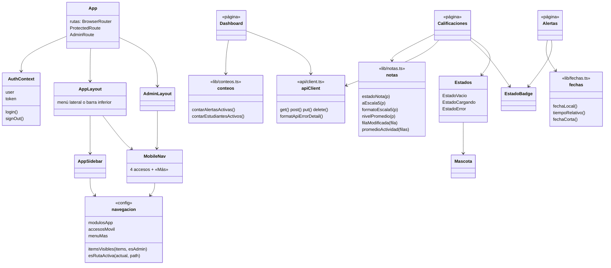
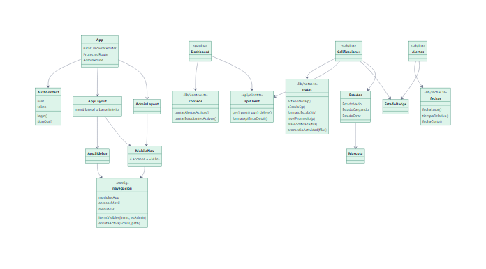
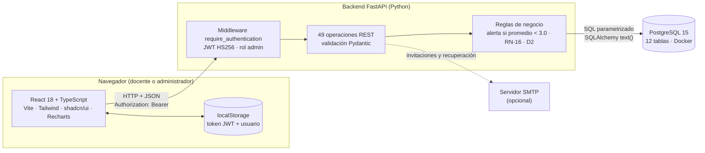
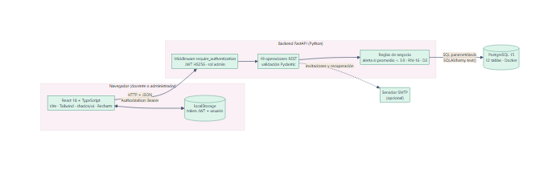
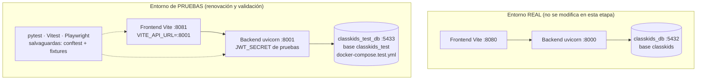
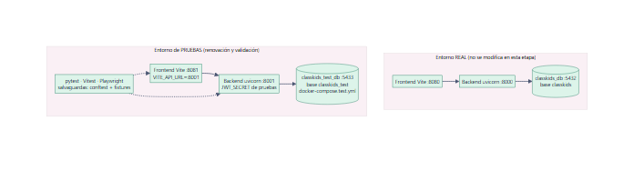

# Diagramas UML, modelo relacional y arquitectura de componentes

Diagramas elaborados el 20/11/2026 a partir del **código entregado** (`backend/main.py`, `frontend/src`) y del **esquema leído en PostgreSQL** (`information_schema` de `classkids_test`, solo lectura). Están en Mermaid, por lo que GitHub los muestra directamente y se pueden editar como texto.

> **Esquema real y esquema de pruebas.** La única diferencia es la columna `calificaciones.entregado`: existe en `classkids_test` (migración 001 aplicada en pruebas) y **no existe todavía** en la base real `classkids`. El backend detecta la columna en tiempo de ejecución (`columna_existe`).

Complementan los diagramas existentes: [MER](mer-classkids.png), [casos de uso](casos-de-uso.png), [arquitectura](arquitectura.png), [flujo del proceso](flujo-proceso.png) y [registro de calificación con alerta](flujo-calificacion-alerta.png).

## 1. Modelo relacional (MR)

El modelo relacional **verificado contra la base real** (columnas, tipos, nulos, valores por defecto, PK, FK, restricciones, índices y acciones `ON DELETE`) está en [`../referencia-tecnica/modelo-relacional.md`](../referencia-tecnica/modelo-relacional.md), con su versión editable en Mermaid, [PNG](modelo-relacional.png) y [PDF](modelo-relacional.pdf).

La columna `calificaciones.entregado` **no existe en la base real**: solo está en `classkids_test`, porque la migración 001 sigue pendiente de autorización.

## 2. Diagrama de clases UML: backend (FastAPI)

El backend no usa ORM: los endpoints son funciones con SQL parametrizado (`sqlalchemy.text`). Las clases reales son los **esquemas Pydantic** que validan las peticiones, y el módulo `main` actúa como controlador. Se muestran los atributos tal como están declarados.

*Imagen generada desde el bloque anterior con `renderizar_mermaid.cjs` (para el documento Word).*

## 3. Diagrama de clases UML: frontend (React + TypeScript)

Componentes y módulos principales de la interfaz renovada. Las flechas indican dependencia (uso).

*Imagen generada desde el bloque anterior con `renderizar_mermaid.cjs` (para el documento Word).*

## 4. Arquitectura de componentes y comunicación entre capas

*Imagen generada desde el bloque anterior con `renderizar_mermaid.cjs` (para el documento Word).*

## 5. Despliegue actual: entorno real y entorno de pruebas aislado

*Imagen generada desde el bloque anterior con `renderizar_mermaid.cjs` (para el documento Word).*

No hay despliegue en servidor público; ver [`despliegue.md`](../despliegue.md).
