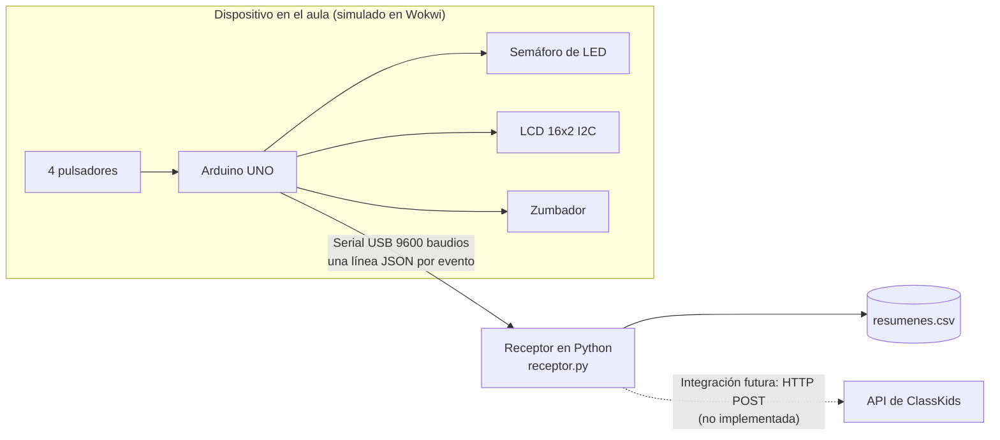
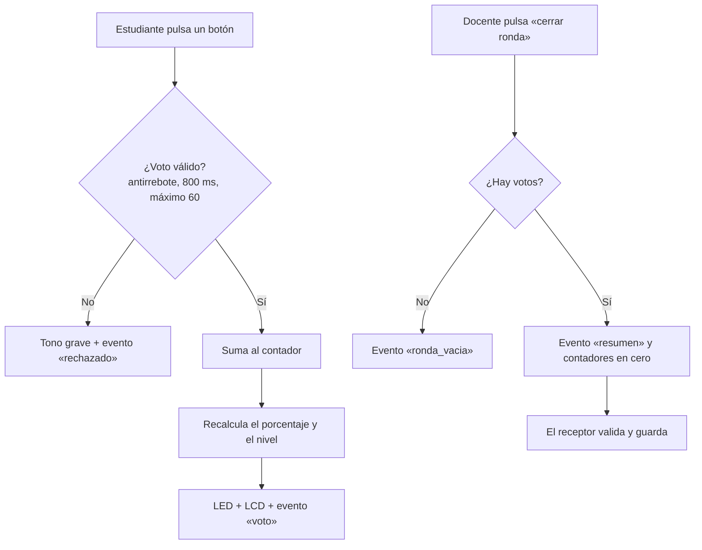
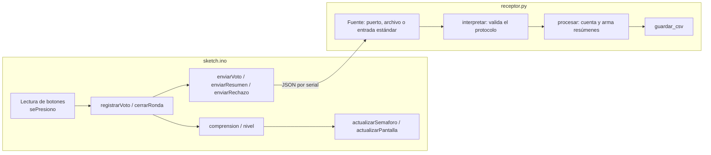
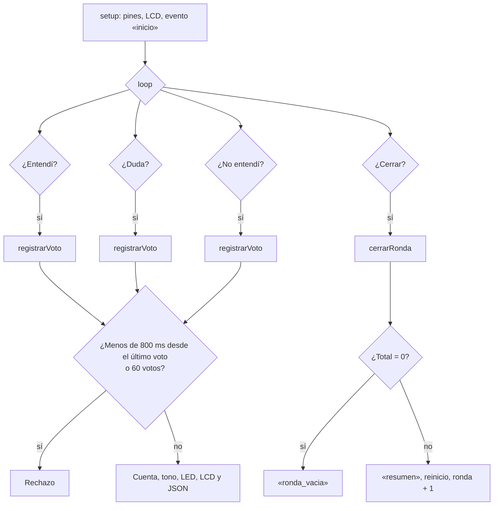
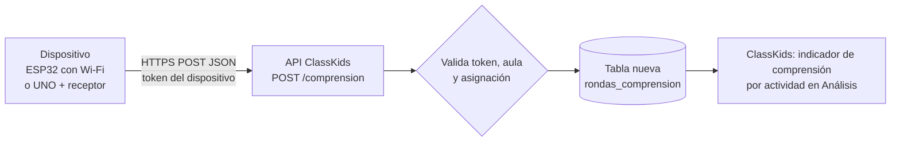

# IoT · Semáforo de Comprensión ClassKids (criterio 6, bonificación)

**Estado al 24/11/2026:**

| Nivel | Estado |
|---|---|
| 1. Propuesta conceptual | **Completa** (este documento) |
| 2. Prototipo simulado en Wokwi | **Implementado y simulado.** El circuito (`diagram.json`), el programa (`sketch.ino`) y el receptor en Python están en [`06_IOT_BONIFICACION/iot/semaforo-comprension/`](../../ENTREGA_FINAL_CLASSKIDS/06_IOT_BONIFICACION/iot/semaforo-comprension/README.md). El proyecto se compiló y ejecutó en Wokwi (<https://wokwi.com/projects/481623698742645761>); la grabación de 106 s y una captura están en `evidencias/`. Pasan las 48 pruebas automáticas y las 9 pruebas manuales. **Sin evidencia:** el tope de 60 votos por ronda. |
| 3. Implementación física | No realizada (no hay montaje con hardware real) |
| 4. Integración con ClassKids | No implementada. Es una propuesta (sección 28) y requiere autorización |

ClassKids **no tiene integración IoT**: el prototipo es independiente y no modifica su backend, frontend ni base de datos.

## 1. Nombre del proyecto
**Semáforo de Comprensión ClassKids**: dispositivo de aula para la retroalimentación anónima de comprensión.

## 2. Descripción de la solución
Durante una explicación, el docente hace una pregunta de verificación, por ejemplo «¿quedó clara la suma con llevadas?», y los estudiantes votan de forma anónima con tres botones: «Entendí», «Tengo dudas» o «No entendí».

- El dispositivo cuenta los votos y calcula el porcentaje de comprensión.
- Un semáforo de LED muestra el nivel del grupo: verde, amarillo o rojo.
- Una pantalla LCD muestra los conteos.
- Con un cuarto botón, el docente cierra la ronda: el dispositivo envía un resumen en JSON por el puerto serial y un programa en Python lo valida y lo guarda.

## 3. Problema identificado
ClassKids registra calificaciones **después** de cada actividad. Las alertas aparecen cuando el promedio ya bajó de 3.0. El docente no tiene una señal **durante** la clase que le indique si el grupo está entendiendo, y preguntar en voz alta «¿entendieron?» suele producir respuestas sesgadas: pocos estudiantes admiten en público que no entendieron.

## 4. Justificación
- **Encaja con el objetivo de ClassKids:** detectar a tiempo quién necesita apoyo. El semáforo adelanta esa detección al momento de la clase y a nivel de grupo.
- **Es anónimo:** fomenta respuestas honestas y no trata datos personales.
- **Es construible y demostrable:** usa componentes básicos disponibles en Wokwi y reproduce el ciclo IoT de la formación: sensor o entrada → microcontrolador → mensaje JSON por serial → programa en Python.

## 5. Objetivo general
Construir un prototipo IoT simulado que recoja la percepción de comprensión de un grupo durante la clase, la muestre en tiempo real y transmita resúmenes estructurados a un programa receptor.

## 6. Objetivos específicos
1. Registrar votos anónimos de tres opciones con antirrebote y protección contra votos repetidos.
2. Calcular el porcentaje de comprensión y representarlo en un semáforo de tres niveles.
3. Enviar los eventos por el puerto serial con un protocolo JSON documentado.
4. Validar los mensajes y guardar los resúmenes en un programa receptor en Python.
5. Verificar el prototipo con pruebas automáticas y manuales.

## 7. Alcance

| Incluye | No incluye |
|---|---|
| Circuito simulado en Wokwi (Arduino UNO, LCD I2C, 4 botones, 3 LED, zumbador) | Montaje físico |
| Programa del Arduino y protocolo JSON por serial | Comunicación inalámbrica |
| Receptor en Python que valida los mensajes y guarda un CSV | Conexión con la API o la base de datos de ClassKids |
| Pruebas automáticas y lista de pruebas manuales | Identificación de estudiantes (es anónimo por diseño) |

## 8. Escenario de uso
1. La docente de Matemáticas de 1A explica un tema y pregunta «¿quedó clara la suma con llevadas?».
2. Los estudiantes pasan por turnos y pulsan un botón.
3. El semáforo queda en rojo (33 %): la docente repite la explicación con otro ejemplo.
4. En la segunda ronda queda en verde (75 %).
5. Al cerrar cada ronda, el resumen queda guardado en el computador del aula.

## 9. Usuarios involucrados

| Usuario | Interacción |
|---|---|
| Estudiantes | Votan de forma anónima. No inician sesión: son los mismos registros que ya maneja ClassKids, no usuarios del sistema |
| Docente | Hace la pregunta, observa el semáforo y cierra la ronda |
| Administrador (a futuro) | Registraría los dispositivos de cada aula si se integra con ClassKids |

## 10. Arquitectura propuesta



## 11. Diagrama general



## 12. Diagrama de componentes



## 13. Diagrama de flujo del programa



## 14. Componentes electrónicos

| Componente | Cantidad | Pieza en Wokwi |
|---|---|---|
| Arduino UNO R3 | 1 | `wokwi-arduino-uno` |
| Pantalla LCD 16x2 con adaptador I2C (PCF8574, dirección 0x27) | 1 | `wokwi-lcd1602` con `"pins": "i2c"` |
| Pulsador (verde, amarillo, rojo y azul) | 4 | `wokwi-pushbutton` |
| LED (verde, amarillo y rojo) | 3 | `wokwi-led` |
| Resistencia de 220 Ω | 3 | `wokwi-resistor` |
| Zumbador piezoeléctrico | 1 | `wokwi-buzzer` |

## 15. Función de cada componente
- **Arduino UNO:** lee los botones, calcula, controla las salidas y envía el protocolo.
- **Botones:** entradas de los votos y del cierre de ronda. Usan la resistencia interna (`INPUT_PULLUP`).
- **LED con resistencia:** forman el semáforo. Las resistencias limitan la corriente.
- **LCD:** muestra los conteos y el porcentaje.
- **Zumbador:** confirma o rechaza cada voto con un tono.

## 16. Conexiones y pines

| Componente | Pin |
|---|---|
| Botones Entendí, Duda, No entendí y Cerrar | 2, 3, 4 y 5 (el otro lado a GND) |
| Zumbador | 8 (+) y GND (−) |
| LED verde, amarillo y rojo | 9, 10 y 12, cada uno con una resistencia de 220 Ω, y cátodo a GND |
| LCD | SDA → A4, SCL → A5, VCC → 5V, GND → GND |

El LED rojo usa el pin 12 y no el 11: `tone()` ocupa el Timer2, que también controla el pin 11. Las pruebas automáticas comprueban que `diagram.json` y `sketch.ino` usan los mismos pines.

## 17. Comunicación
- **Medio:** serial USB, 9600 baudios, 8N1. Es la misma configuración de las actividades de Arduino de la formación.
- **Formato:** una línea JSON por evento: `inicio`, `voto`, `rechazado`, `resumen` y `ronda_vacia`. Los ejemplos están en el [README del prototipo](../../ENTREGA_FINAL_CLASSKIDS/06_IOT_BONIFICACION/iot/semaforo-comprension/README.md#protocolo-de-comunicación).
- **Recepción:**
  - con hardware real, el receptor lee el puerto (`--puerto COM3`);
  - con la extensión Wokwi de VS Code, lee la simulación por TCP (`rfc2217://localhost:4000`);
  - en wokwi.com se copia el monitor serial a un archivo (`--archivo`).

## 18. Datos generados
Por ronda: dispositivo (aula), número de ronda, conteos de cada opción, total, porcentaje de comprensión y nivel. El receptor agrega la fecha y hora de recepción y la marca «requiere refuerzo» cuando el nivel es rojo. **No hay datos personales.**

## 19. Procesamiento de información

**En el Arduino:**
- antirrebote de 30 ms;
- bloqueo de 800 ms entre votos;
- tope de 60 votos por ronda;
- comprensión = `(entendí × 100 + total / 2) / total`;
- nivel: ≥ 70 % verde, ≥ 40 % amarillo, < 40 % rojo.

**En Python:**
- valida la estructura y los tipos;
- recalcula la comprensión y el nivel, y rechaza los mensajes inconsistentes;
- ignora el ruido;
- guarda los resúmenes en CSV.

## 20. Seguridad
- El prototipo no tiene red ni credenciales: la superficie de ataque es el acceso físico al dispositivo.
- El receptor no ejecuta lo que recibe. Solo interpreta JSON y valida los campos, así que los mensajes manipulados o corruptos se descartan.
- Riesgo propio de la votación: alguien podría votar varias veces. El bloqueo de 800 ms y el tope por ronda lo mitigan, pero no lo eliminan. Es un indicador de clase, no una evaluación.
- En una integración futura, el envío a ClassKids necesitaría autenticación del dispositivo y HTTPS (sección 28).

## 21. Privacidad
- **Anonimato por diseño:** no se identifica quién vota.
- **Nada se asocia a estudiantes:** el resumen pertenece al aula y a la ronda.
- **Coherente con las políticas de ClassKids:** cumple la protección de datos de menores de [`../politicas/proteccion-datos.md`](../politicas/proteccion-de-datos.md), porque no recoge datos personales.

## 22. Costos estimados (hardware físico, referencia)
Precios aproximados de tiendas de electrónica en Colombia (noviembre de 2026), sin verificar con proveedores. En simulación el costo es cero.

| Componente | Valor aproximado (COP) |
|---|---|
| Arduino UNO (compatible) | 35.000 |
| LCD 16x2 con módulo I2C | 18.000 |
| 4 pulsadores, 3 LED, 3 resistencias | 5.000 |
| Zumbador | 3.000 |
| Protoboard y cables | 15.000 |
| **Total** | **≈ 76.000** |

## 23. Limitaciones
- Un solo dispositivo por aula y votación por turnos, no simultánea.
- No impide que una persona vote más de una vez, aunque lo dificulta.
- Sin red: los datos llegan solo al computador conectado.
- La comprensión es autorreportada, así que es una percepción y no una medición del aprendizaje.
- En la simulación no hay evidencia del tope de 60 votos por ronda (sección 25).
- En wokwi.com el receptor no lee la simulación en vivo: hay que copiar el monitor serial a un archivo.

## 24. Riesgos

| Riesgo | Mitigación |
|---|---|
| Que el sketch no compile en Wokwi por una diferencia de la biblioteca | Usa la biblioteca `LiquidCrystal I2C` que Wokwi recomienda y solo funciones estándar (`init`, `backlight`, `setCursor`, `print`, `clear`) |
| Que se vote sin pensar o por juego | Explicar el propósito, cerrar rondas cortas y no usarlo como nota |
| Que se use para señalar a estudiantes | El diseño anónimo lo impide |
| Que se confunda con una función de ClassKids | Este documento y el README lo declaran independiente |

## 25. Pruebas

### Automáticas: ejecutadas el 25/11/2026, 48 de 48 aprobadas

Comando, desde la raíz: `python -m pytest ENTREGA_FINAL_CLASSKIDS/06_IOT_BONIFICACION/iot/semaforo-comprension/pruebas`.

| Grupo | Casos | Qué comprueban |
|---|---|---|
| Cálculos | 20 | Redondeo de la comprensión, incluidos los porcentajes que mostró la simulación (40, 38, 29, 14 y 33 %), y límites del semáforo (70, 69, 40, 39 % y sin datos) |
| Protocolo | 16 | Resumen válido; 8 tipos de mensaje mal formado; resúmenes inconsistentes; sesión completa con ruido y línea cortada; CSV; el ejemplo del protocolo; **el registro serial de la grabación y el copiado de Wokwi**, y el resumen de la captura; el receptor en una consola de Windows |
| Circuito frente al código | 12 | Piezas y pines reales de Wokwi; cada botón, LED, resistencia, zumbador y la LCD en el pin que declara el sketch; pines sin repetir y libres del serial; mismos umbrales y fórmula en el sketch y en Python; textos de hasta 16 columnas |

El receptor se ejecutó sobre el registro serial transcrito de la grabación (`evidencias/registro-serial-transcrito-de-la-grabacion.txt`):

```
Ronda 1: Entendí 3, Dudas 4, No entendí 3 -> 30 % (rojo)  <- requiere refuerzo
Ronda 2: Entendí 2, Dudas 3, No entendí 4 -> 22 % (rojo)  <- requiere refuerzo
2 resumen(es) guardado(s) en evidencias/resumenes-desde-la-grabacion.csv
Votos: 19 · Rechazados: 7 · Rondas vacías: 0 · Líneas inválidas: 0 · Ignoradas: 2
```

Al ejecutarlo por primera vez en una consola de Windows, el receptor se detenía con `UnicodeEncodeError` al mostrar las flechas «→» y «←». Se corrigió con flechas ASCII, y una prueba lo comprueba (falla con la versión anterior).

### Manuales en Wokwi: ejecutadas por el equipo el 24 y el 25/11/2026
La grabación (106 s) muestra el arranque, dos rondas completas, votos rechazados y los tres colores del semáforo. Cada estado de la LCD coincide con la fórmula. El detalle de las 9 pruebas, con su resultado y el segundo de la grabación que lo demuestra, está en el [README del prototipo](../../ENTREGA_FINAL_CLASSKIDS/06_IOT_BONIFICACION/iot/semaforo-comprension/README.md#manuales-en-wokwi).

**Aprobadas:** 9 de 9.
- **La grabación** demuestra siete.
- **El monitor serial copiado de Wokwi** (`evidencias/registro-wokwi.txt`, 25/11/2026) demuestra las otras dos:
  - 7 de 10 «Entendí» → 70 %, verde;
  - cierre sin votos → `ronda_vacia`.

El receptor procesó ese registro con 10 votos, 1 rechazado, 1 ronda vacía, un solo resumen y 0 líneas inválidas (`evidencias/resumenes.csv`). Siempre leyó archivos, nunca la simulación en vivo.

## 26. Resultados esperados
- Simulación que responde a los cuatro botones con los LED, la LCD y el zumbador.
- Mensajes JSON que el receptor acepta sin líneas inválidas.
- Un CSV con un resumen por ronda.
- Una demostración de 2 a 3 minutos para la sustentación:
  1. arrancar la simulación;
  2. votar hasta rojo;
  3. «repetir la explicación» y votar hasta verde;
  4. cerrar las rondas;
  5. pasar el registro al receptor.

## 27. Conclusiones
- El Semáforo de Comprensión aplica IoT a un problema real del aula, coherente con el propósito de ClassKids: actuar a tiempo.
- Respeta la privacidad por diseño y usa componentes básicos simulables.
- Su protocolo documentado permite integrarlo más adelante sin rehacer el dispositivo.
- La simulación en Wokwi confirma el funcionamiento: las 9 pruebas manuales están aprobadas (sección 25).

## 28. Integración futura con ClassKids (propuesta, no implementada)



| Componente | Propuesta |
|---|---|
| Dispositivo | Pasar a ESP32 (Wi-Fi) o mantener el UNO y que el receptor en Python reenvíe por HTTP |
| Comunicación | HTTPS con un token por dispositivo; el resumen ya tiene el formato JSON |
| API futura | `POST /comprension`, que asocia el resumen a una actividad y un grupo del docente (respetando sus asignaciones) |
| Base de datos | Tabla nueva `rondas_comprension` (actividad, grupo, ronda, conteos, porcentaje, fecha). **Requiere autorización de cambio de esquema** |
| Visualización | Indicador de comprensión por actividad en Análisis, junto al promedio de las notas |

Nada de esto existe hoy. Se probaría primero en `classkids_test`, y solo con autorización.

## 29. Alternativas evaluadas y decisión

| Criterio | A. Monitor de condiciones del aula (temperatura, humedad y luz) | B. Asistencia con tarjeta o código | **C. Semáforo de comprensión** |
|---|---|---|---|
| Utilidad educativa | Media: confort del aula | Alta: la asistencia es administrativa | Alta: retroalimentación durante la clase |
| Relación con el seguimiento académico | Baja (indirecta) | Media (ausentismo) | **Alta** (comprensión por tema, adelanta las alertas) |
| Viabilidad técnica | Alta | Media: Wokwi no tiene lector RFID, habría que usar un teclado | **Alta** |
| Componentes en Wokwi | DHT22, LDR, LCD | Teclado, LCD | **Botones, LED, LCD y zumbador** |
| Complejidad para ADSO | Baja | Media | **Baja-media** |
| Costo estimado | ≈ 70.000 COP | ≈ 90.000 COP con RFID | **≈ 76.000 COP** |
| Facilidad de demostración | Media (hay que «simular el clima») | Media | **Alta** (interactiva) |
| Seguridad y privacidad | Sin datos personales | **Datos personales de menores** (identidad y horario) | **Anónimo** |
| Integración futura | Débil | Requiere tabla de asistencia y documentos | Natural: indicador por actividad |

**Decisión: alternativa C.**
- Es la única con relación directa con el seguimiento académico.
- No trata datos personales de menores.
- Se demuestra de forma interactiva con componentes básicos de Wokwi.
- La alternativa B, que la versión anterior de este documento mencionaba, se descartó por privacidad y porque Wokwi no simula lectores RFID.

## Anexo. Búsqueda de actividades previas (23/11/2026)

Se buscaron actividades IoT del equipo, con estas palabras clave: Arduino, IoT, sensores, serial, MQTT, ESP32, `.ino`. No se encontró nada en:
- el repositorio;
- el documento versión 1.0;
- `Estructura proyecto Class Kids.docx`;
- las carpetas del equipo en este computador.

Si el equipo tiene la actividad de Arduino de la formación (sensor, serial, JSON y Python), puede añadirse como evidencia complementaria. El Semáforo de Comprensión sigue el mismo ciclo.
