# Manual de usuario

Este manual explica cómo usar ClassKids en su versión actual. Está dirigido a docentes y administradores de la institución. Cada sección incluye capturas reales de la versión vigente, tomadas el 23/11/2026 con los datos de demostración (las de la página de inicio y el video, el 24/11/2026); el catálogo completo está en el capítulo de interfaces.

## Qué puede hacer cada rol

Desde el 24/11/2026 cada docente trabaja solo con sus **asignaciones**: las materias que el administrador le asignó en cada grupo.

| Tarea | Docente | Administrador |
|---|---|---|
| Ver grupos, estudiantes y materias | Solo los grupos donde dicta y sus materias | Todos |
| Crear grupos y materias, y asignar docentes | No | Sí |
| Registrar y editar estudiantes | Solo en sus grupos | Sí |
| Crear actividades y registrar notas | Solo de su materia en ese grupo | Sí |
| Registrar observaciones | Solo de estudiantes de sus grupos | Sí |
| Ver indicadores y alertas | Solo de sus asignaciones | De todo el colegio |
| Gestionar usuarios | No | Sí (no puede cambiar su propio rol ni desactivarse) |

Si un docente intenta abrir información que no le corresponde, el sistema no la muestra y responde «No tienes asignado este grupo o esta materia».

## 1. Ingreso al sistema

### Ver el recorrido en video (página de inicio)

1. En la página de inicio de ClassKids, vaya a «Conoce cómo funciona ClassKids» (enlace «Recorrido» del menú o botón «Conoce ClassKids»).
2. Pulse «Ver video». El video no se reproduce solo y empieza con música instrumental a volumen bajo.
3. Para silenciar la música, pulse el botón del altavoz junto a «Volumen»; púlselo de nuevo para activarla. Con el control «Volumen» la ajusta. También sirven los controles del reproductor (pausa, avance, pantalla completa).

### Activar la cuenta (primera vez)

1. El administrador le enviará una invitación a su correo. Si el sistema no tiene correo configurado, el administrador le compartirá el enlace directamente.
2. Abra el enlace antes de 48 horas.
3. Escriba sus nombres, apellidos y una contraseña de al menos 6 caracteres, y confírmela. Por seguridad, la contraseña se debe escribir: no se puede pegar.
4. Verá el mensaje «Cuenta activada. Ya puedes iniciar sesión.»

### Iniciar sesión

1. Ingrese a la plataforma y pulse «Iniciar sesión».
2. Escriba su **correo electrónico** y su contraseña y pulse «Iniciar sesión». Con el botón del ojo puede mostrar u ocultar la contraseña mientras la escribe.
3. Si los datos son correctos, entrará al Dashboard. Si no lo son, el mensaje aparece debajo del formulario (por ejemplo, «El correo o la contraseña no son correctos.»). Si la cuenta está desactivada, comuníquese con el administrador.
4. Al pie del formulario están los enlaces a Términos, Privacidad y Protección de datos.

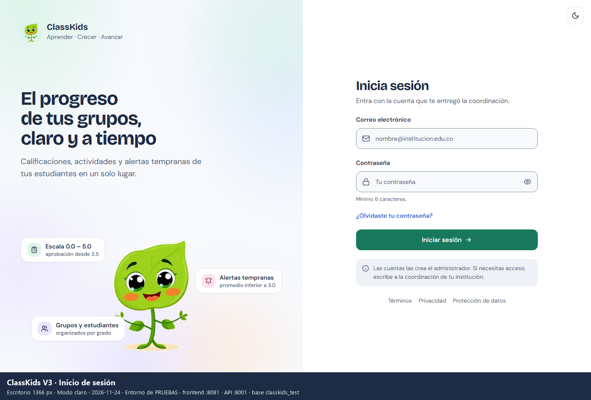

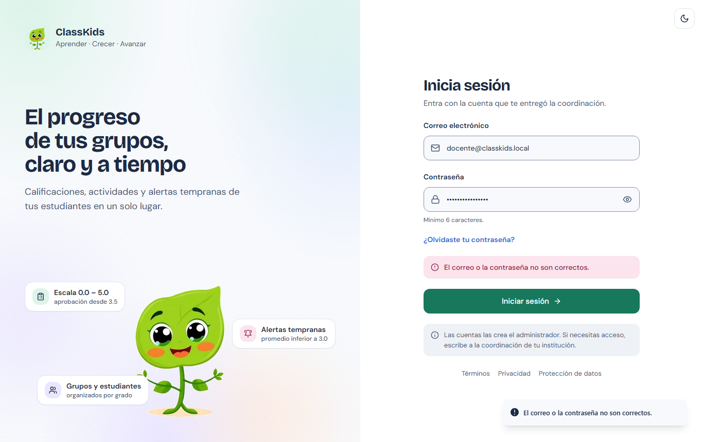

### Recuperar la contraseña

1. En la pantalla de inicio de sesión pulse «¿Olvidaste tu contraseña?».
2. Escriba su correo y pulse «Enviar enlace».
3. Abra el enlace que llega a su correo (vence en 30 minutos), escriba la nueva contraseña, confírmela y guárdela.

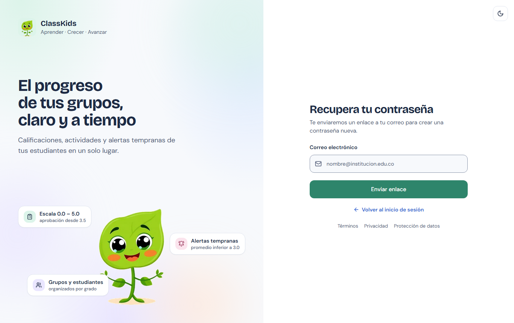

### Cerrar sesión

En el computador, pulse «Cerrar sesión» en la parte inferior del menú lateral. En el celular, abra «Más» y pulse «Salir». Hágalo siempre al terminar, sobre todo en equipos compartidos.

> Si el administrador desactiva su cuenta o cambia su rol mientras usted trabaja, la plataforma lo lleva al inicio de sesión con el aviso «Tu cuenta ya no está activa» o «Tu rol cambió». Si el sistema muestra errores al cargar cualquier pantalla, es posible que su sesión haya vencido (dura 8 horas) o que el servidor se haya reiniciado: cierre sesión y vuelva a ingresar.

## 2. Navegación

**En el computador y la tableta**, el menú lateral contiene los módulos: Dashboard, Grupos, Estudiantes, Materias, Actividades, Calificaciones, Análisis y Alertas.
- El módulo activo se resalta con su color.
- Junto a «Alertas» aparece el número de alertas activas.
- El botón con la flecha contrae o expande el menú; en pantallas estrechas se contrae solo.
- En la parte inferior se ven su correo, su rol y el botón «Cerrar sesión».
- Si usted es administrador, verá además «Panel admin».

**Modo claro y oscuro.** El botón con el sol o la luna cambia el tema de toda la plataforma. Está en el menú lateral, en la cabecera del celular, en la página de inicio y en el inicio de sesión. La preferencia se guarda en el navegador: se mantiene al navegar y al volver a entrar.

**En el celular**, la barra inferior tiene cinco accesos: **Inicio, Estudiantes, Calificaciones, Alertas y Más**.
- «Más» abre los demás módulos: Grupos, Actividades, Análisis y Materias.
- Si usted es administrador, «Más» incluye también Usuarios y Panel de administración.
- Al final de «Más» están su cuenta y el botón «Salir».

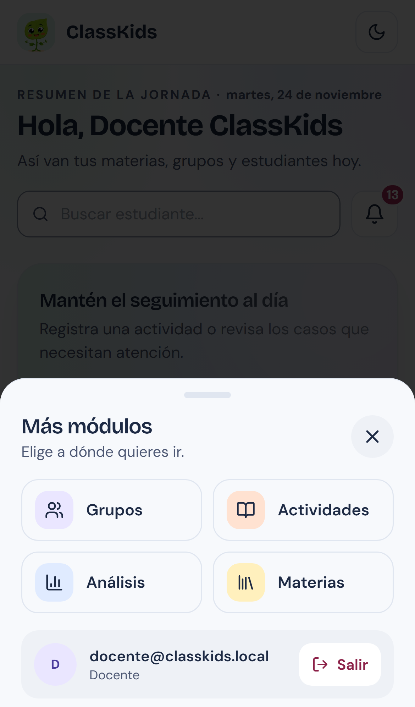

## 3. Dashboard

Es la primera pantalla al ingresar. Muestra:

- Un buscador para ir directamente a un estudiante.
- Los accesos «Nueva actividad» y «Revisar alertas».
- Los totales de grupos, estudiantes activos, actividades y alertas activas.
- La gráfica de rendimiento por materia. Cada barra muestra el promedio en porcentaje y en la escala 0.0–5.0, y las líneas punteadas marcan 3.0 (alerta) y 3.5 (aprobación).
- El panel «Alertas tempranas», con las cinco alertas activas más recientes y el grupo de cada estudiante. El contador indica el total; el enlace «Ver las N alertas activas» abre la lista completa. Las resueltas no se eliminan: se consultan con el enlace «Ver alertas resueltas».
- «Seguimiento de estudiantes»: los primeros estudiantes de la lista con su promedio, su estado y su tendencia. «Ver todos» abre la pantalla Estudiantes.
- **Solo para el docente:** «Mis asignaciones», una fila por cada materia que dicta en cada grupo, con el número de estudiantes, las notas registradas y el promedio de esa materia en ese grupo. Los totales, la gráfica y las alertas del Dashboard se calculan solo con sus asignaciones.
- **Para el administrador:** los totales y la gráfica corresponden a todo el colegio.

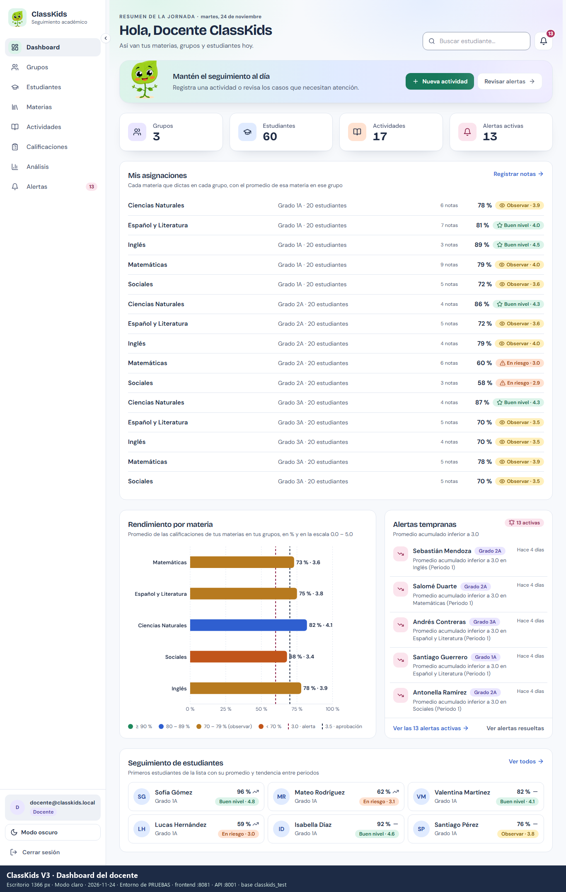

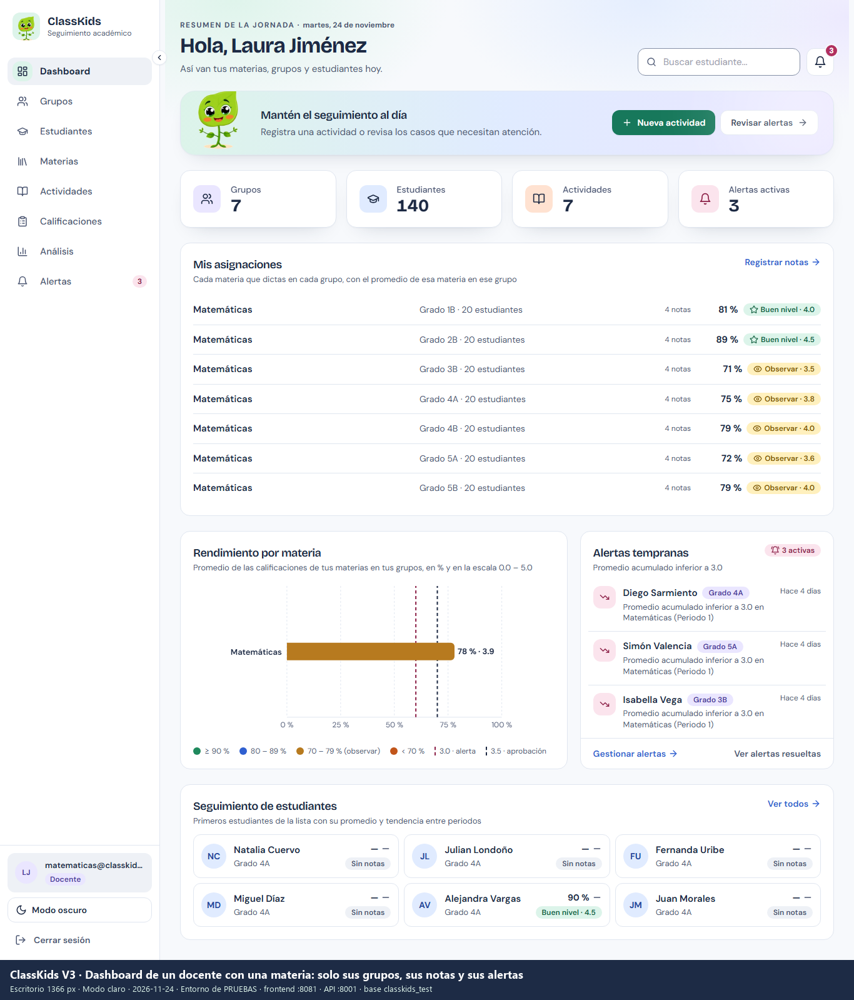

## 4. Grupos

- Consulte cada grupo con su número de estudiantes y actividades, su promedio, sus alertas abiertas y su nivel de rendimiento.
- Use el buscador y los filtros de grado y turno.
- Para crear un grupo, pulse «Nuevo Grupo», elija el curso (de 1.°A a 5.°B) y el turno, y pulse «Crear grupo».
- «Ver estudiantes del grupo» abre la pantalla Estudiantes filtrada por ese grupo.
- El nivel de rendimiento se muestra con color e ícono: Excelente, Bueno, Regular (70–79 %, aprobado) o En riesgo.

> El docente ve solo los grupos donde tiene materias asignadas. Crear grupos es tarea del administrador (botón «Nuevo Grupo»). En la versión actual los grupos no se pueden editar ni eliminar desde la pantalla.

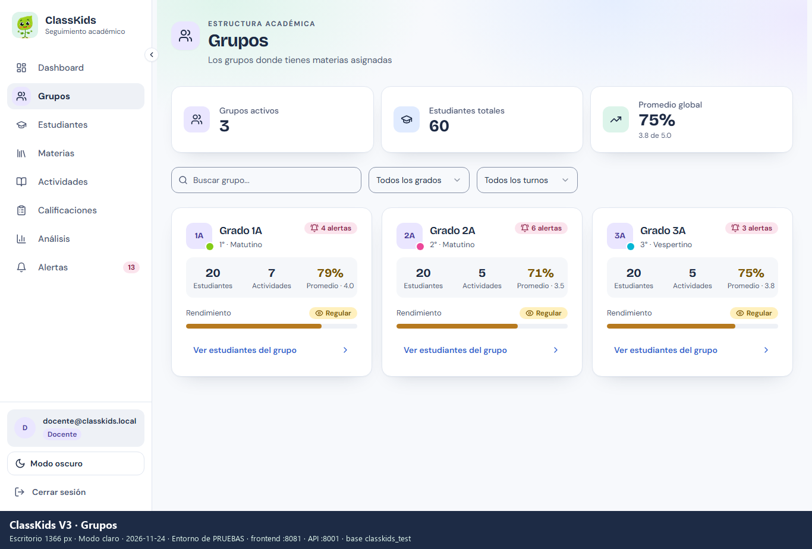

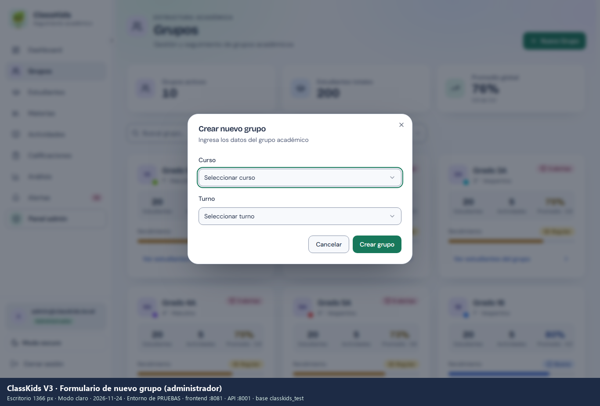

## 5. Estudiantes

- La tabla muestra el grupo, el promedio (en porcentaje), la tendencia, el estado (Activo, En riesgo o Crítico) y las alertas de cada estudiante.
- Busque por nombre o filtre por grupo y por estado; los filtros se pueden combinar.
- La lista muestra 25 estudiantes por página; use «Anterior» y «Siguiente» para recorrerla. En el celular, cada estudiante aparece como una tarjeta.

- **Registrar:** pulse «Nuevo Estudiante», complete documento, nombre, apellido y grupo, y pulse «Registrar». El documento no puede repetirse.
- **Consultar el detalle:** haga clic en el estudiante para ver su promedio, estado, tendencia, alertas activas y observaciones.
- **Editar:** en el detalle, pulse «Editar», modifique los datos y pulse «Guardar cambios». El formulario muestra los datos actuales del estudiante, incluido su grupo.

> El docente ve y registra estudiantes solo en sus grupos. En la versión actual los estudiantes no se pueden eliminar desde la pantalla; en la API, eliminar es exclusivo del administrador.

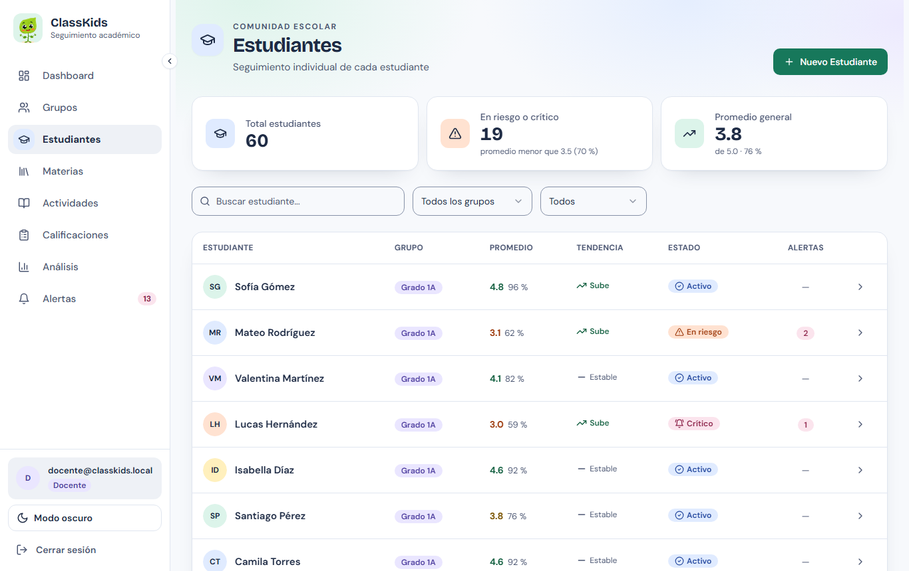

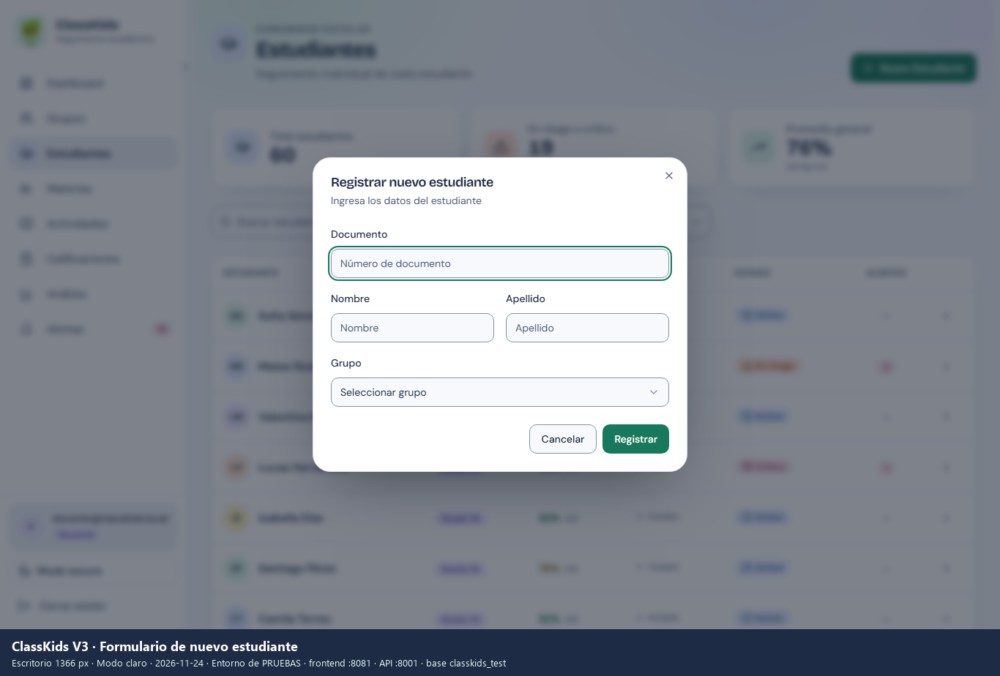

## 6. Observaciones

1. Abra el detalle de un estudiante.
2. En la sección Observaciones pulse «Nueva».
3. Elija el tipo (Académica, Convivencial o Reconocimiento), escriba la observación y pulse «Guardar».
4. Para eliminar una observación, use el ícono de eliminar junto a ella.

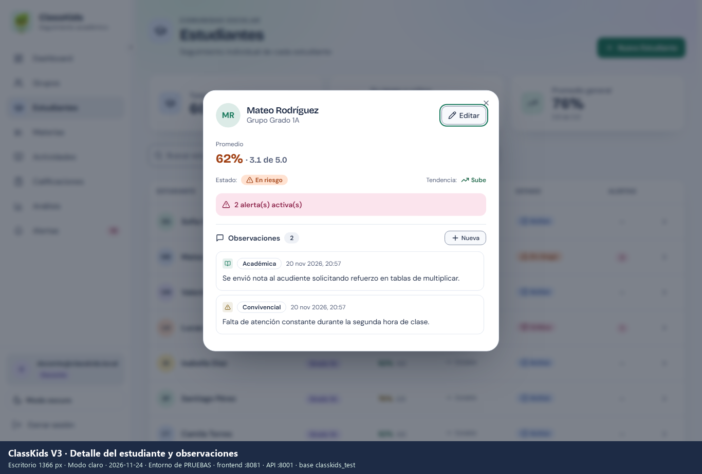

## 7. Materias y asignaciones

**Docente:** consulta sus materias, cuántos grupos tiene en cada una y, en «Vista por Grupos», sus asignaciones. No ve los botones de crear, vincular ni eliminar.

**Administrador:**

- **Catálogo de Materias:** pulse «Nueva Materia», escriba el nombre y pulse «Crear Materia». Para eliminar una materia, use el ícono de eliminar y confirme en el diálogo; no se puede eliminar una materia que ya tenga actividades o calificaciones.
- **Vista por Grupos:** muestra qué docente dicta cada materia en cada grupo. Para asignar, pulse «Vincular a Grupo», elija docente, materia y grupo, y pulse «Vincular». Cada materia admite un solo docente por grupo.

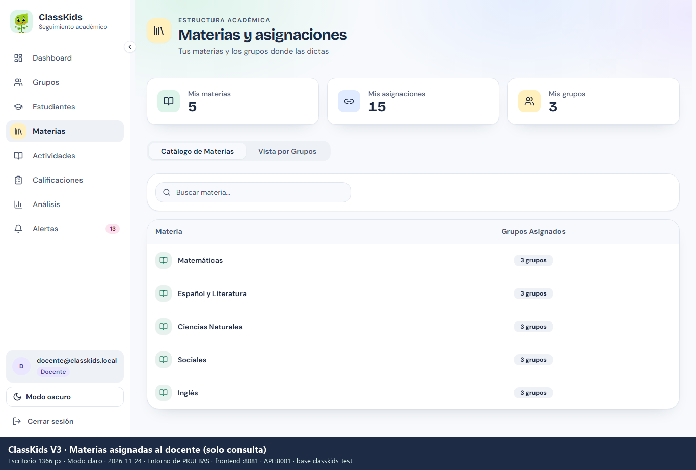

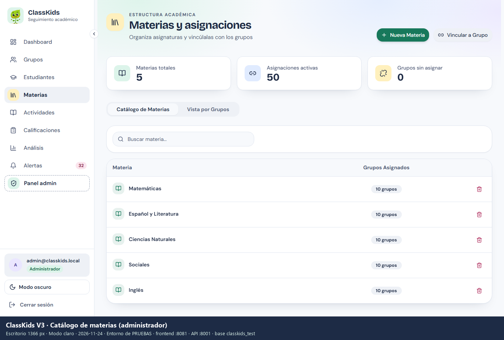

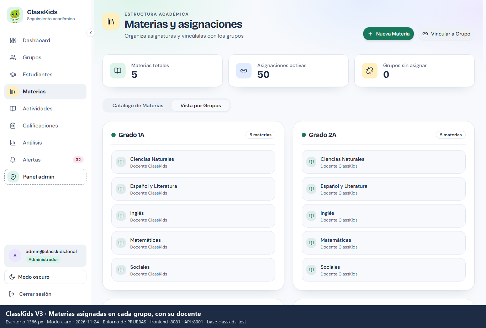

## 8. Actividades

- Consulte las actividades con su tipo, grupo, fecha de entrega, progreso de entrega, estado (Pendiente, Completada o Vencida) y promedio. La pantalla puede tardar unos segundos en cargar. «Entregados» indica cuántos estudiantes del grupo tienen la entrega registrada.
- Filtre por tipo, estado o grupo.
- Para crear una actividad, pulse «Nueva Actividad», complete título, tipo, grupo, fecha de entrega y materia (la descripción es opcional) y pulse «Crear actividad». Al elegir el grupo, el docente solo ve las materias que tiene asignadas en ese grupo.
- El docente ve solo las actividades de sus materias en sus grupos.

> En la versión actual las actividades no se pueden editar ni eliminar desde la pantalla.

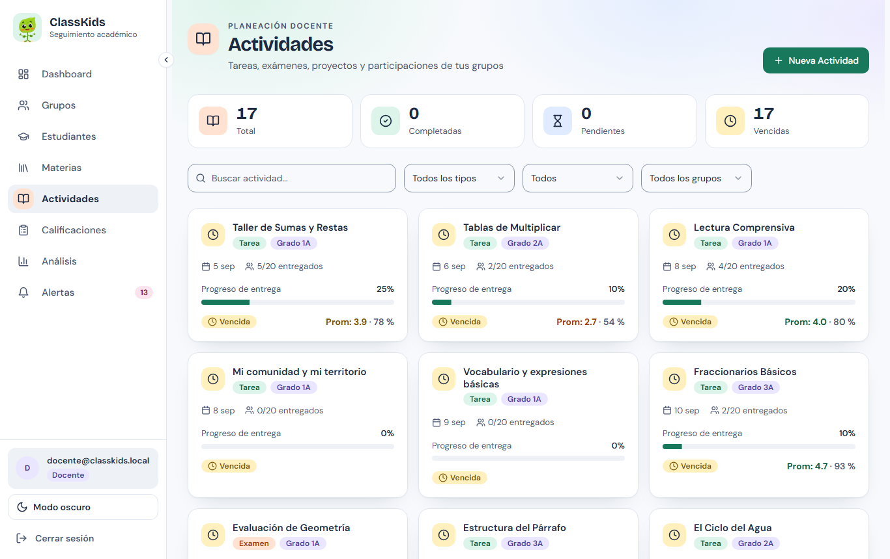

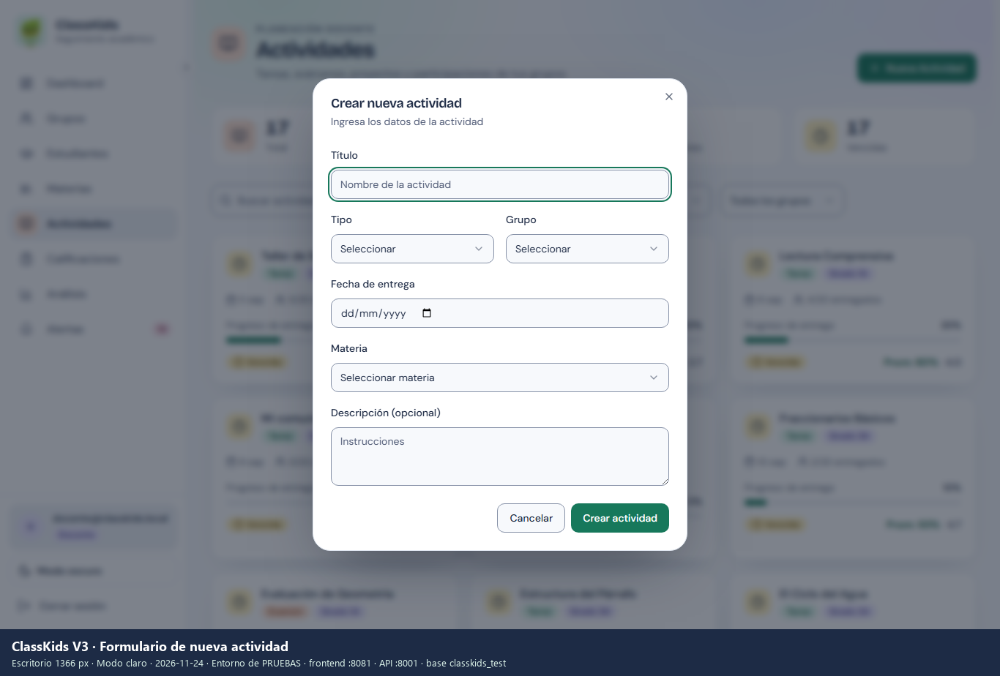

## 9. Calificaciones

El docente solo ve los grupos y las actividades de sus asignaciones, y solo puede calificar a estudiantes de un grupo donde dicta esa materia.

**Escala.** La escala académica oficial de ClassKids es de **0.0 a 5.0**. Para facilitar la digitación, esta pantalla trabaja en porcentaje: el valor que usted escribe se divide entre 20 al guardar y se almacena con un decimal.

| Usted escribe (%) | Se guarda (escala oficial) | Estado en pantalla |
|---|---|---|
| 100 | 5.0 | Excelente |
| 90 | 4.5 | Excelente |
| 80 | 4.0 | Aprobado |
| 70 | 3.5 | Aprobado |
| 60 | 3.0 | Reprobado |
| 50 | 2.5 | Reprobado |

1. Elija el grupo y luego la actividad.
2. Escriba o cambie la calificación de los estudiantes en porcentaje (0 a 100). Los estudiantes sin nota aparecen con el campo vacío («—»). Desde 70 (3.5) se muestra como Aprobado y desde 90 (4.5) como Excelente.
3. Marque o desmarque «Entregado» según corresponda.
4. Junto a cada nota verá su equivalencia en la escala oficial, por ejemplo «86 / 100 = 4.3». Es solo informativa: se guarda el mismo valor de siempre.
5. Las filas que modificó se resaltan en amarillo con la leyenda «Sin guardar», y el botón indica cuántas son: pulse «Guardar cambios (n)». Si no hay cambios, el botón está desactivado. En el celular, el botón aparece en una barra sobre la navegación inferior.
6. Si cambia el tamaño de la ventana o gira la tableta, las notas digitadas se conservan.

> Solo se guardan las filas que usted modificó: los estudiantes que deja sin nota no reciben un 0, y el comentario y el periodo de las calificaciones existentes se conservan. Las calificaciones nuevas se registran en el periodo 1. Para registrar la entrega de un estudiante sin nota, primero ingrese su calificación.
>
> **Base de datos real:** hasta que se aplique la migración 001, el estado «Entregado» no se conserva al recargar (vuelve a aparecer marcado para toda calificación registrada).
>
> Use preferiblemente porcentajes pares: como la escala oficial tiene un decimal, un valor como 73 se guarda como 3.6 o 3.7 y luego se muestra como 72 o 74 (hallazgo H-03).

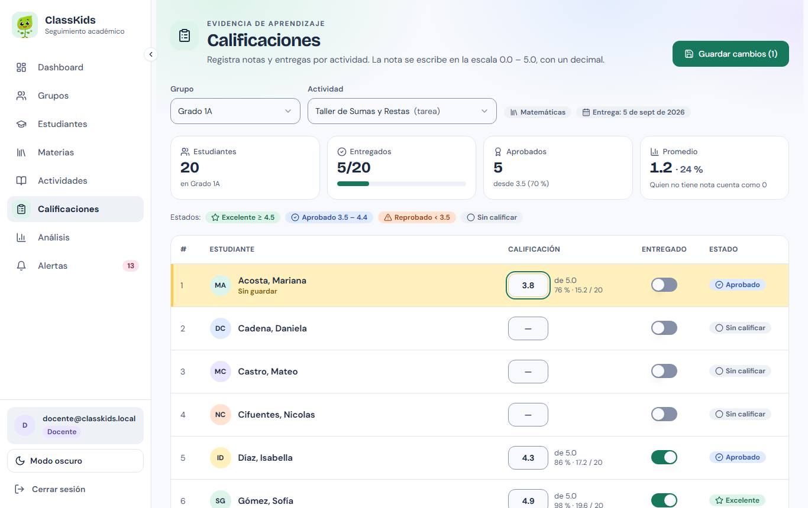

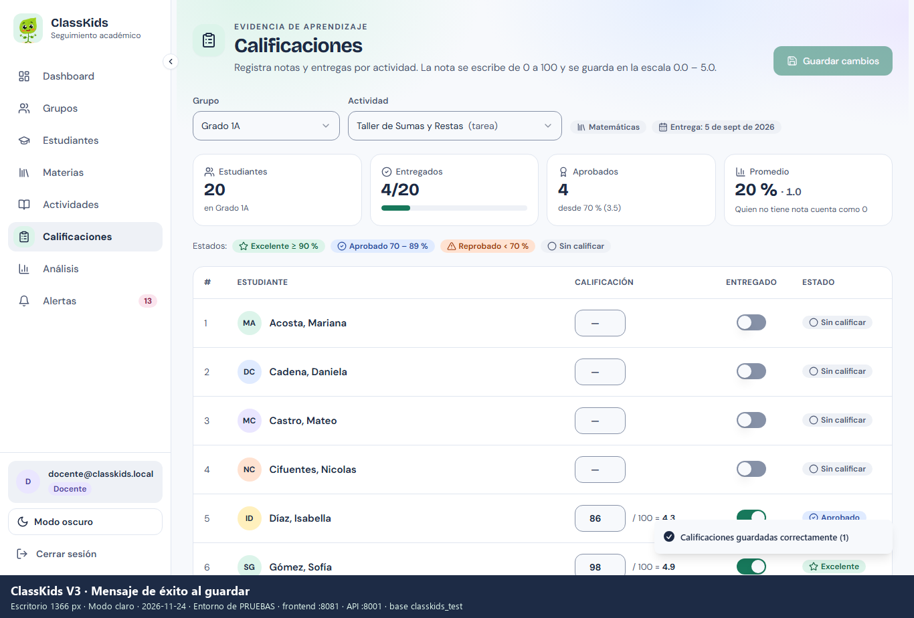

## 10. Análisis

Muestra el promedio general, el número de estudiantes y de estudiantes en riesgo, la variación frente al mes anterior y cuatro gráficas: rendimiento por grupo, distribución de rendimiento, tendencia mensual y rendimiento por tipo de actividad. Las gráficas muestran líneas punteadas en 3.0 (alerta) y 3.5 (aprobación), y al pasar el cursor o tocar una barra se ve el promedio en porcentaje y en la escala 0.0–5.0. Al final aparece la tabla de estudiantes en riesgo, ordenada del promedio más bajo al más alto: «Crítico» (menos de 60 %, es decir, menos de 3.0) y «En riesgo» (de 60 % a 69 %, entre 3.0 y 3.4).

- Si usted tiene varias materias, use el selector **«Materia»** (arriba a la derecha) para ver los indicadores de una sola materia; «Todas las materias» vuelve al conjunto. Si tiene una sola materia, el selector no aparece.
- El docente ve solo los datos de sus asignaciones; el administrador, los de todo el colegio.

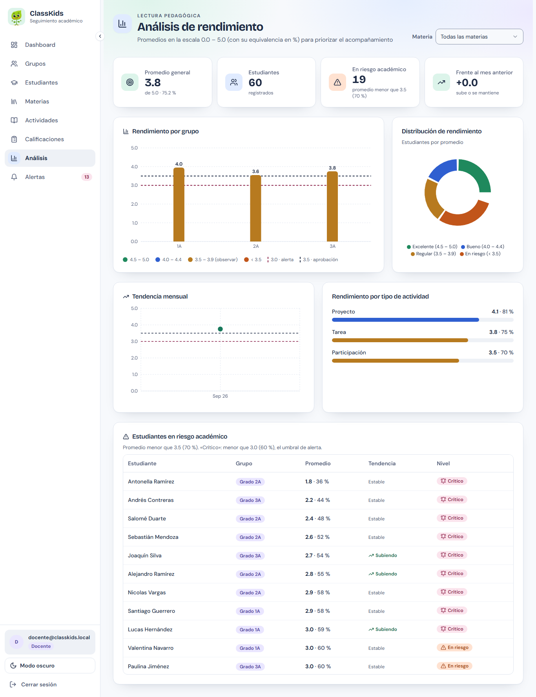

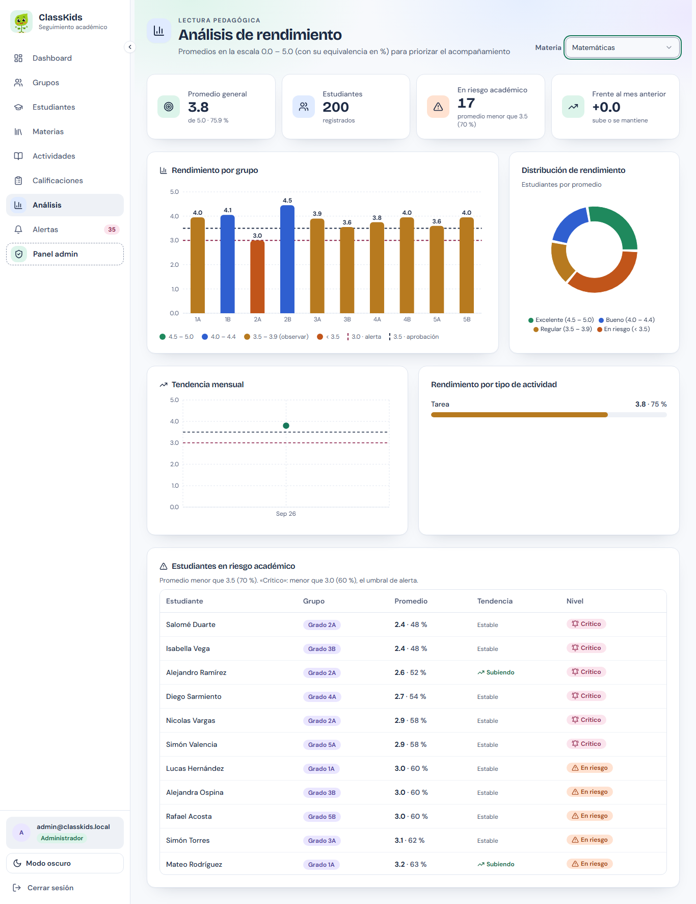

## 11. Alertas

- El sistema crea una alerta automáticamente cuando, al registrar una nueva calificación, el promedio acumulado del estudiante en la escala oficial queda por debajo de 3.0 (60 %). Al editar una calificación existente no se evalúa la alerta.
- La pantalla muestra cuántas alertas están activas, en revisión y resueltas, y permite filtrarlas por tipo y estado. El filtro «Resueltas» funciona como historial: las alertas resueltas se conservan. El enlace «Ver alertas resueltas» del Dashboard abre esta pantalla con ese filtro aplicado.
- Si un estudiante ya tiene una alerta de bajo rendimiento activa o en revisión, el sistema no crea otra.
- El docente ve las alertas de los estudiantes de sus grupos. Si el mensaje de una alerta nombra una materia, solo la ve el docente de esa materia en ese grupo.
- Cada alerta muestra el estudiante, su grupo, el estado (Activa, En revisión o Resuelta), la prioridad y hace cuánto se creó. Las tarjetas de totales también sirven como filtro rápido.
- Haga clic en una alerta para ver su detalle (mensaje, grupo, tipo, estado, prioridad y fecha) y pulse «Marcar en revisión» cuando inicie el seguimiento, o «Resolver» cuando el caso esté atendido. Una alerta resuelta no se puede reabrir ni se elimina.

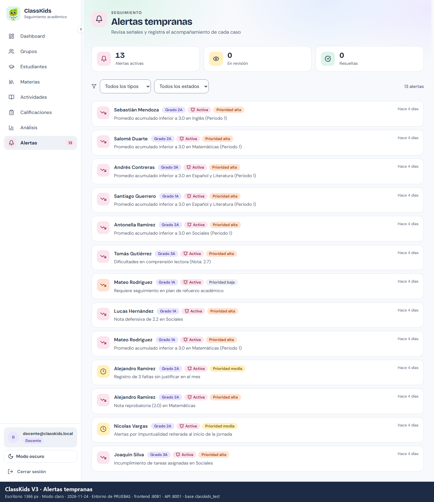

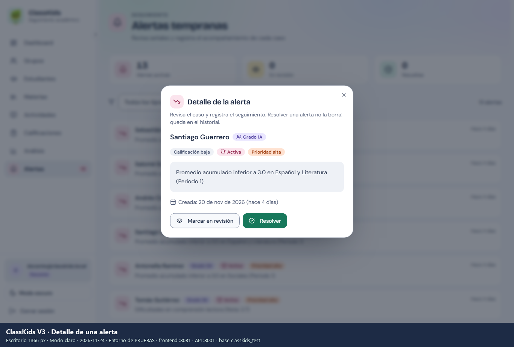

## 12. Panel de administración (solo administradores)

- **Resumen:** métricas de docentes, administradores, grupos, estudiantes, actividades y alertas activas.
- **Usuarios:**
  - Para invitar a alguien, pulse «Invitar docente», escriba el correo, elija el rol y pulse «Enviar invitación». Si el sistema no envía correos, copie el «Enlace de prueba» y compártalo.
  - Para cambiar el rol de un usuario, use el selector de su fila.
  - Para desactivar a un usuario, use el ícono de desactivar (en el celular, el botón «Desactivar») y confirme en el diálogo. El usuario ya no podrá ingresar; su historial no se borra.
  - Su propia fila aparece marcada «(tú)»: el sistema no le permite cambiar su propio rol ni desactivar su propia cuenta.
  - Las materias y grupos de cada docente se asignan en Materias → «Vincular a Grupo».
- **Datos globales:** consulta de solo lectura de grupos (con su año lectivo), estudiantes y alertas.
- **Gestión académica:** abre los módulos académicos con la información de todo el colegio.

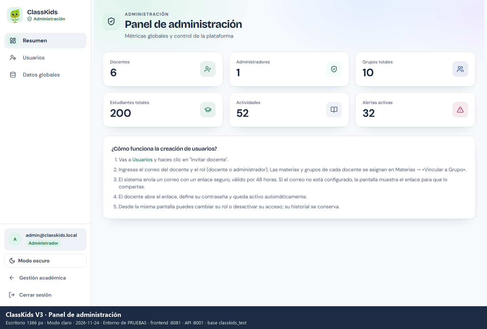

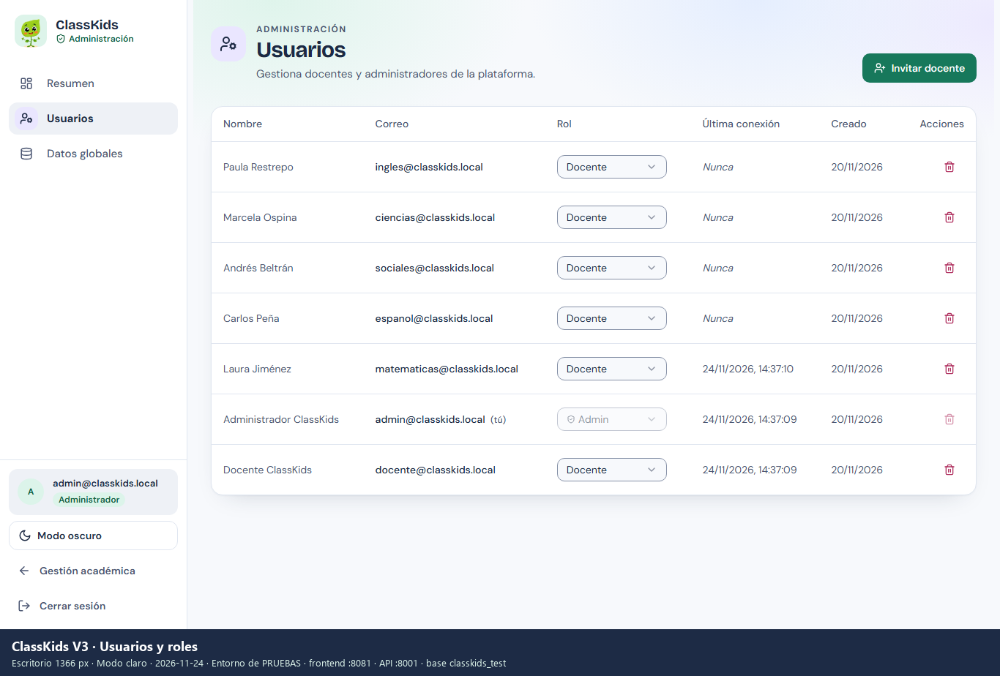

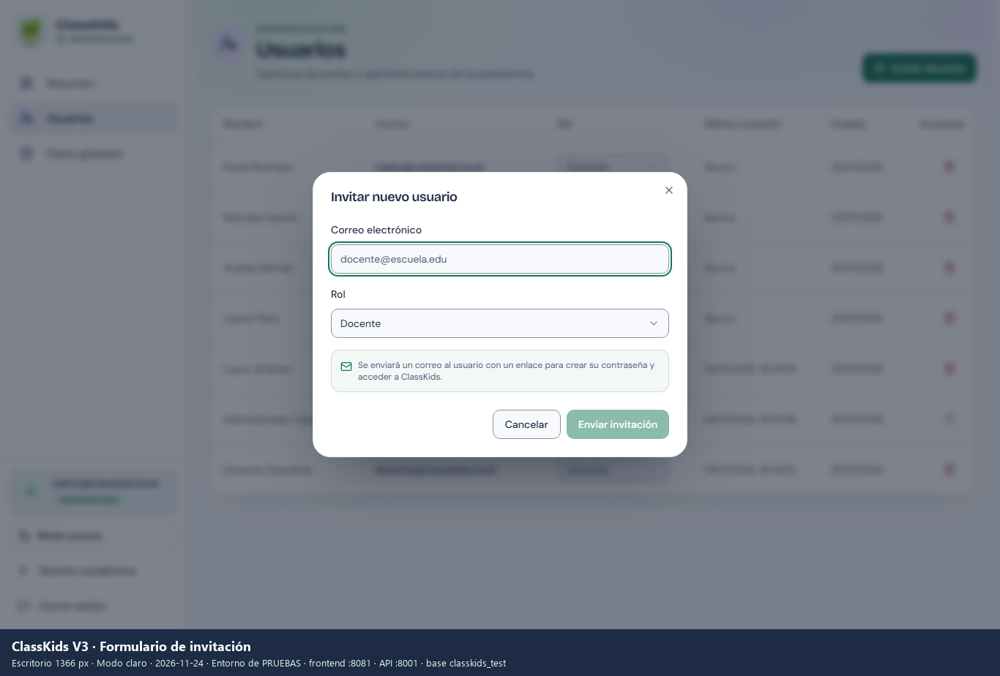

## 13. Preguntas frecuentes

| Pregunta | Respuesta |
|---|---|
| ¿Puedo registrarme yo mismo? | No. El acceso es solo por invitación del administrador. |
| No me llegó el correo de invitación o de recuperación. | El sistema solo envía correos si el servidor tiene configurado un servicio SMTP. Pida al administrador el enlace de invitación. |
| ¿Por qué un estudiante aparece «En riesgo» pero no tiene alertas? | Las pantallas marcan en riesgo a quien tiene un promedio menor a 3.5 (70 %), mientras que la alerta automática se genera solo con un promedio menor a 3.0 (60 %). Es una diferencia conocida (H-01). |
| ¿Por qué veo porcentajes si la escala es de 0 a 5? | La escala oficial es 0.0–5.0. Las pantallas muestran cada nota multiplicada por 20 para expresarla en porcentaje; por ejemplo, 4.3 se ve como 86 %. |
| ¿En qué periodo se guardan las notas? | En el periodo 1; la versión actual no permite elegirlo. |
