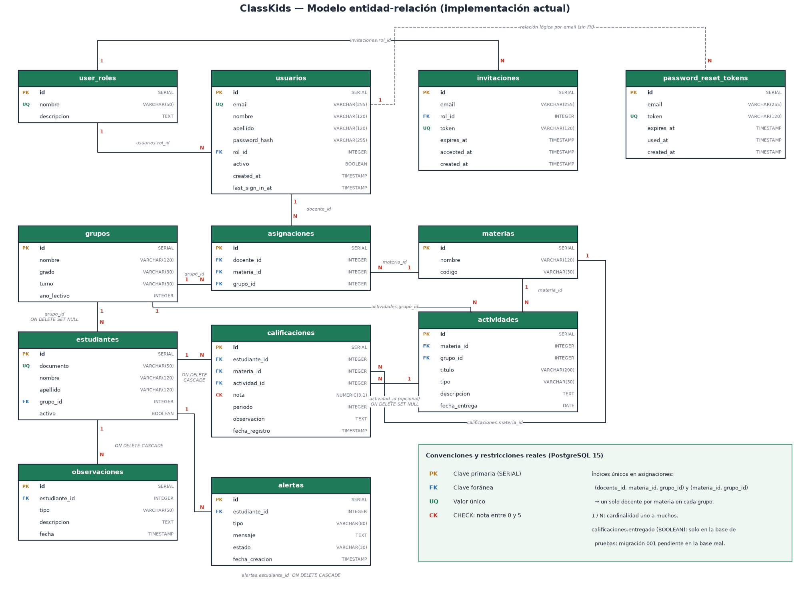

# Modelo de datos

> **Actualización del 23/11/2026:** el modelo relacional y el diccionario de datos se volvieron a verificar contra la base real, incluidos valores por defecto, índices y acciones `ON DELETE`. Resultado: [`modelo-relacional.md`](modelo-relacional.md); diferencias: [`modelo-relacional-diferencias.md`](modelo-relacional-diferencias.md). Este capítulo coincide con esa verificación salvo los conteos de registros, que corresponden al 20/11/2026.

La base de datos de ClassKids se implementa en PostgreSQL 15. La información de este capítulo se obtuvo directamente del catálogo de la base de datos en ejecución (`information_schema` y `pg_constraint`) el 20/11/2026, y coincide con `backend/init.sql`.

## Modelo entidad-relación

## Tablas

| Tabla | Propósito | Registros en los datos demo |
|---|---|---|
| `user_roles` | Catálogo de roles (Administrador, Docente, Acudiente). | 3 |
| `usuarios` | Personas que ingresan a la plataforma (administradores y docentes). | 8 (1 administrador y 7 docentes) |
| `invitaciones` | Invitaciones enviadas para crear cuentas. | 1 |
| `password_reset_tokens` | Enlaces de recuperación de contraseña. | 8 |
| `grupos` | Cursos de la institución. | 10 |
| `estudiantes` | Estudiantes y su grupo. | 200 |
| `materias` | Asignaturas. | 5 |
| `asignaciones` | Docente responsable de cada materia en cada grupo. Desde el 24/11/2026 también define el alcance de cada docente en la API (RF-26, RN-33 a RN-38). | 50 |
| `actividades` | Tareas, exámenes, proyectos y participaciones. | 52 |
| `calificaciones` | Notas de los estudiantes. | 215 |
| `observaciones` | Anotaciones cualitativas sobre estudiantes. | 10 |
| `alertas` | Alertas académicas y su estado de seguimiento. | 32 |

## Relaciones entre docentes, materias, grupos, estudiantes y actividades

El núcleo académico del modelo se organiza así:

1. **Grupo – Estudiante (1:N).** Un grupo tiene muchos estudiantes y cada estudiante pertenece a un solo grupo (`estudiantes.grupo_id`). El campo admite valor nulo: si se elimina el grupo, el estudiante queda sin grupo (`ON DELETE SET NULL`).
2. **Docente – Materia – Grupo (asignación).** La tabla `asignaciones` relaciona un usuario docente (`docente_id`), una materia y un grupo. Un docente puede tener muchas asignaciones; una materia puede dictarse en muchos grupos; y por el índice único `(materia_id, grupo_id)` cada materia tiene **un solo docente por grupo**.
3. **Materia y Grupo – Actividad (1:N).** Cada actividad pertenece a una materia y a un grupo (`actividades.materia_id`, `actividades.grupo_id`, ambos obligatorios). La actividad no guarda qué docente la creó ni se valida contra las asignaciones.
4. **Estudiante y Actividad – Calificación.** La calificación relaciona a un estudiante con una materia y, opcionalmente, con una actividad (`actividad_id` admite nulo). También guarda su propia `materia_id`, que duplica la de la actividad.
5. **Estudiante – Observación y Estudiante – Alerta (1:N).** Un estudiante puede tener muchas observaciones y muchas alertas. Si el estudiante se elimina, se eliminan en cascada sus calificaciones, observaciones y alertas.
6. **Rol – Usuario (1:N).** Cada usuario tiene un rol (`usuarios.rol_id`). Las invitaciones también indican el rol que tendrá la nueva cuenta.
7. **Usuario – Token de recuperación.** Se relacionan por el correo electrónico, sin clave foránea.

## Diccionario de datos

Convenciones: **PK** clave primaria, **FK** clave foránea, **UQ** valor único, **NN** no admite nulos.

### user_roles

| Campo | Tipo | Restricciones | Descripción |
|---|---|---|---|
| id | SERIAL | PK | Identificador del rol. |
| nombre | VARCHAR(50) | NN, UQ | Nombre del rol: Administrador, Docente o Acudiente. |
| descripcion | TEXT | | Descripción del rol. |

### usuarios

| Campo | Tipo | Restricciones | Descripción |
|---|---|---|---|
| id | SERIAL | PK | Identificador del usuario. |
| email | VARCHAR(255) | NN, UQ | Correo de acceso. Se compara sin distinguir mayúsculas. |
| nombre | VARCHAR(120) | NN | Nombres. |
| apellido | VARCHAR(120) | | Apellidos. |
| password_hash | VARCHAR(255) | NN | Hash PBKDF2-SHA256 de la contraseña. |
| rol_id | INTEGER | FK → user_roles.id | Rol del usuario. |
| activo | BOOLEAN | NN, por defecto TRUE | FALSE cuando el administrador desactiva la cuenta. |
| created_at | TIMESTAMP | NN, por defecto fecha actual | Fecha de creación. |
| last_sign_in_at | TIMESTAMP | | Fecha y hora del último inicio de sesión. |

### invitaciones

| Campo | Tipo | Restricciones | Descripción |
|---|---|---|---|
| id | SERIAL | PK | Identificador de la invitación. |
| email | VARCHAR(255) | NN | Correo invitado. |
| rol_id | INTEGER | NN, FK → user_roles.id | Rol que tendrá la cuenta. |
| token | VARCHAR(120) | NN, UQ | Código secreto del enlace de invitación. |
| expires_at | TIMESTAMP | NN | Vencimiento (48 horas después de crearse). |
| accepted_at | TIMESTAMP | | Fecha de aceptación; nulo si no se ha usado. |
| created_at | TIMESTAMP | NN, por defecto fecha actual | Fecha de creación. |

### password_reset_tokens

| Campo | Tipo | Restricciones | Descripción |
|---|---|---|---|
| id | SERIAL | PK | Identificador. |
| email | VARCHAR(255) | NN | Correo del usuario que solicitó la recuperación. |
| token | VARCHAR(120) | NN, UQ | Código secreto del enlace. |
| expires_at | TIMESTAMP | NN | Vencimiento (30 minutos). |
| used_at | TIMESTAMP | | Fecha de uso; nulo si no se ha usado. |
| created_at | TIMESTAMP | NN, por defecto fecha actual | Fecha de creación. |

### grupos

| Campo | Tipo | Restricciones | Descripción |
|---|---|---|---|
| id | SERIAL | PK | Identificador del grupo. |
| nombre | VARCHAR(120) | NN | Nombre del curso, por ejemplo «Grado 3A». |
| grado | VARCHAR(30) | | Grado, por ejemplo «3°». |
| turno | VARCHAR(30) | | Jornada: Matutino o Vespertino. |
| ano_lectivo | INTEGER | por defecto 2026 | Año lectivo. En la API se recibe como `año_lectivo`. |

### estudiantes

| Campo | Tipo | Restricciones | Descripción |
|---|---|---|---|
| id | SERIAL | PK | Identificador del estudiante. |
| documento | VARCHAR(50) | NN, UQ | Número de identificación. |
| nombre | VARCHAR(120) | NN | Nombres. |
| apellido | VARCHAR(120) | NN | Apellidos. |
| grupo_id | INTEGER | FK → grupos.id, ON DELETE SET NULL | Grupo al que pertenece. |
| activo | BOOLEAN | NN, por defecto TRUE | Indicador de estudiante activo. La interfaz actual no lo modifica. |

### materias

| Campo | Tipo | Restricciones | Descripción |
|---|---|---|---|
| id | SERIAL | PK | Identificador de la materia. |
| nombre | VARCHAR(120) | NN | Nombre de la asignatura. |
| codigo | VARCHAR(30) | | Código interno, por ejemplo «MAT-01». |

### asignaciones

| Campo | Tipo | Restricciones | Descripción |
|---|---|---|---|
| id | SERIAL | PK | Identificador de la asignación. |
| docente_id | INTEGER | NN, FK → usuarios.id | Docente responsable. |
| materia_id | INTEGER | NN, FK → materias.id | Materia dictada. |
| grupo_id | INTEGER | NN, FK → grupos.id | Grupo. |

Índices únicos: `(docente_id, materia_id, grupo_id)` y `(materia_id, grupo_id)`.

### actividades

| Campo | Tipo | Restricciones | Descripción |
|---|---|---|---|
| id | SERIAL | PK | Identificador de la actividad. |
| materia_id | INTEGER | NN, FK → materias.id | Materia de la actividad. |
| grupo_id | INTEGER | NN, FK → grupos.id | Grupo que la realiza. |
| titulo | VARCHAR(200) | NN | Título. |
| tipo | VARCHAR(30) | NN, por defecto 'tarea' | tarea, examen, proyecto o participación. |
| descripcion | TEXT | | Instrucciones. |
| fecha_entrega | DATE | | Fecha límite. |

### calificaciones

| Campo | Tipo | Restricciones | Descripción |
|---|---|---|---|
| id | SERIAL | PK | Identificador de la calificación. |
| estudiante_id | INTEGER | NN, FK → estudiantes.id, ON DELETE CASCADE | Estudiante calificado. |
| materia_id | INTEGER | NN, FK → materias.id | Materia. |
| actividad_id | INTEGER | FK → actividades.id, ON DELETE SET NULL | Actividad evaluada (opcional). |
| nota | NUMERIC(3,1) | NN, CHECK 0 ≤ nota ≤ 5 | Nota en la escala académica oficial 0.0–5.0, con un decimal. La interfaz la muestra como porcentaje (nota × 20). |
| periodo | INTEGER | NN, por defecto 1 | Periodo académico. |
| observacion | TEXT | | Comentario; la interfaz guarda «Actividad entregada». |
| fecha_registro | TIMESTAMP | NN, por defecto fecha actual | Fecha de registro. |
| entregado | BOOLEAN | NN, por defecto TRUE | Estado «Entregado» de la calificación (H-31). **Existe solo en la base de pruebas `classkids_test`** (migración 001). **No existe en la base real `classkids`** hasta que se autorice y aplique la migración. |

> El campo `observacion` ya no se usa para registrar la entrega: al editar una calificación desde la interfaz, la observación existente se conserva.

### observaciones

| Campo | Tipo | Restricciones | Descripción |
|---|---|---|---|
| id | SERIAL | PK | Identificador de la observación. |
| estudiante_id | INTEGER | NN, FK → estudiantes.id, ON DELETE CASCADE | Estudiante observado. |
| tipo | VARCHAR(50) | por defecto 'Convivencial' | Académica, Convivencial o Reconocimiento. |
| descripcion | TEXT | NN | Contenido de la observación. |
| fecha | TIMESTAMP | NN, por defecto fecha actual | Fecha y hora de registro. |

### alertas

| Campo | Tipo | Restricciones | Descripción |
|---|---|---|---|
| id | SERIAL | PK | Identificador de la alerta. |
| estudiante_id | INTEGER | NN, FK → estudiantes.id, ON DELETE CASCADE | Estudiante relacionado. |
| tipo | VARCHAR(80) | NN | Tipo en texto libre: `low_grade` (automática), «Bajo Rendimiento», «Inasistencia», «Seguimiento». |
| mensaje | TEXT | NN | Descripción de la alerta. |
| estado | VARCHAR(30) | NN, por defecto 'active' | `active`, `reviewed` o `resolved`. |
| fecha_creacion | TIMESTAMP | NN, por defecto fecha actual | Fecha de creación. |

## Observaciones sobre el modelo

| Aspecto | Situación actual | Impacto |
|---|---|---|
| Unicidad de calificaciones | No existe restricción única sobre `(estudiante_id, actividad_id)`; en los datos demo hay pares repetidos. | Un estudiante puede tener dos notas en la misma actividad. |
| Calificaciones sin actividad | 183 de las 215 calificaciones demo no tienen actividad asociada. | No aparecen en la pantalla Calificaciones, que filtra por actividad. |
| Duplicidad de materia | `calificaciones.materia_id` repite la materia de la actividad. | Pueden quedar datos incoherentes. |
| Tipos y estados de alerta | Texto libre, sin catálogo ni CHECK. | Conviven `low_grade` y «Bajo Rendimiento». |
| Autoría | Observaciones, alertas y actividades no registran el usuario que las creó. | No hay trazabilidad del docente responsable. |
| Materia de la alerta | `alertas` no tiene `materia_id`; la regla automática usa el promedio acumulado de todas las materias. | Desde el 24/11/2026 la visibilidad de cada alerta para el docente depende de su grupo y, si el mensaje nombra una materia, de esa materia (RN-37). Guardar la materia requeriría una migración (pendiente de decisión). |
| Grupos y materias | Sin restricción única por nombre. | Se pueden crear grupos o materias repetidos. |
| Fecha de creación de grupos | `grupos` no tiene `created_at`. | La pantalla «Datos globales» ya no la muestra: presenta el año lectivo (H-26, corregido). |
| Nombre del año lectivo | La columna es `ano_lectivo`. | La API ya usa `ano_lectivo` y acepta también el nombre anterior `año_lectivo` (H-27, corregido). |
| Estado de entrega | En la base real no existe una columna para la entrega. | Pendiente de la migración 001 (ver «Esquema real y esquema de pruebas»). |
| Periodo | Sin CHECK de rango. | Se acepta cualquier entero. |
| Rol Acudiente | Existe en `user_roles` sin funcionalidad. | Reservado para una versión futura. |
| Migraciones | El esquema se crea con `init.sql` la primera vez; no hay herramienta de migraciones. | Volver a ejecutar el script sobre una base existente duplicaría datos. |

Estas observaciones se registran como hallazgos; no se modificó la estructura de la base de datos.

## Esquema real y esquema de pruebas

| Aspecto | Base real `classkids` (DBeaver, puerto 5432) | Base de pruebas `classkids_test` (puerto 5433) |
|---|---|---|
| Uso | Datos con los que trabaja la aplicación | Solo pruebas automatizadas; se puede borrar y recrear |
| Creación | `init.sql` (una sola vez, al crear el contenedor) | `init.sql` + `backend/migrations/001_calificaciones_entregado.sql` |
| Tablas | 12 | 12 |
| Columnas | **69** | **70** (incluye `calificaciones.entregado`) |
| Datos | Datos demo y lo registrado por los usuarios | Los mismos datos demo, restablecidos en cada recreación |
| Migración 001 | **No aplicada** (pendiente de autorización; ver `Docs/migraciones/001-informe-preparacion.md`) | Aplicada |

El backend funciona con ambos esquemas: detecta al iniciar si la columna `entregado` existe y, si no existe, la ignora.

## Verificación en DBeaver

La información de este capítulo corresponde exactamente a la base de datos que se ve en DBeaver. La conexión `classkids` de DBeaver (`localhost:5432`, base `classkids`, usuario `postgres`) llega al contenedor Docker `classkids_db`, el mismo que usa el backend: se verificó el mismo identificador de sistema (`7681334033728598050`) por IPv4, IPv6 y `localhost`.

Para comprobarlo, abra el script [`../evidencias/scripts/verificacion-bd.sql`](../evidencias/scripts/verificacion-bd.sql) en el editor SQL de DBeaver y ejecútelo completo (Alt + X). Cada consulta debe devolver los valores de la tabla siguiente, registrados el 20/11/2026. Si el sistema se usa después de esa fecha, los conteos de registros pueden cambiar; la estructura (tablas, columnas y restricciones) no cambia.

| Consulta | Qué verifica | Resultado esperado |
|---|---|---|
| V-01 | Servidor | Base `classkids`, PostgreSQL 15.19 |
| V-02 | Registros por tabla | user_roles 3 · usuarios 8 · invitaciones 1 · password_reset_tokens 8 · grupos 10 · estudiantes 200 · materias 5 · asignaciones 50 · actividades 52 · calificaciones 215 · observaciones 10 · alertas 32 |
| V-03 | Estructura | 12 tablas, 69 columnas, 32 restricciones |
| V-04 | Restricciones por tipo | 12 claves primarias, 13 claves foráneas, 6 únicas, 1 CHECK |
| V-05 | Columna de la nota | `numeric`, precisión 3, escala 1, `CHECK (nota >= 0 AND nota <= 5)` |
| V-06 | Usuarios por rol | Administrador activo: 1 · Docente activo: 7 |
| V-07 | Estudiantes por grupo | 20 en cada uno de los 10 grupos (Grado 1A a 5B) |
| V-08 | Asignaciones | 50 asignaciones, 50 pares materia–grupo distintos, 6 docentes asignados |
| V-09 | Notas | Mínima 1.8 · máxima 5.0 · promedio general 3.77 · 31 notas menores a 3.0 |
| V-10 | Calificaciones sin actividad | 183 |
| V-11 | Calificaciones repetidas | 5 pares (actividad, estudiante): (1, 1), (1, 2), (6, 8), (11, 20), (12, 16) |
| V-12 | Alertas por tipo y estado | Bajo Rendimiento activa 29 · Inasistencia activa 2 · Seguimiento activa 1 |
| V-13 | Estudiantes con promedio acumulado < 3.0 | 28 |
| V-14 | Estudiantes con promedio < 3.5 | 66 (coincide con «En riesgo» de la pantalla Análisis) |
| V-15 | Integridad entre capas | 0 · 0 · 0 · 0 |
| V-16 | Columna `grupos.created_at` | 0 filas (la columna no existe; ver H-26) |

> El séptimo docente activo (V-06) se incorporó por invitación y no tiene asignaciones; por eso V-08 muestra 6 docentes asignados.

## Datos de demostración

`backend/init.sql` carga un escenario de colegio con 10 grupos (grados 1.° a 5.°, secciones A y B) de 20 estudiantes cada uno, 5 materias (Matemáticas, Español y Literatura, Ciencias Naturales, Sociales, Inglés), un docente especializado por materia, 52 actividades, 215 calificaciones, 10 observaciones y 32 alertas activas. Las alertas demo se cargaron manualmente en `init.sql` y no coinciden exactamente con la regla automática (hallazgo H-32). Las cuentas demo y sus contraseñas se documentan en el archivo local `backend/CREDENCIALES_LOCALES.md`, que no se publica en el repositorio.
