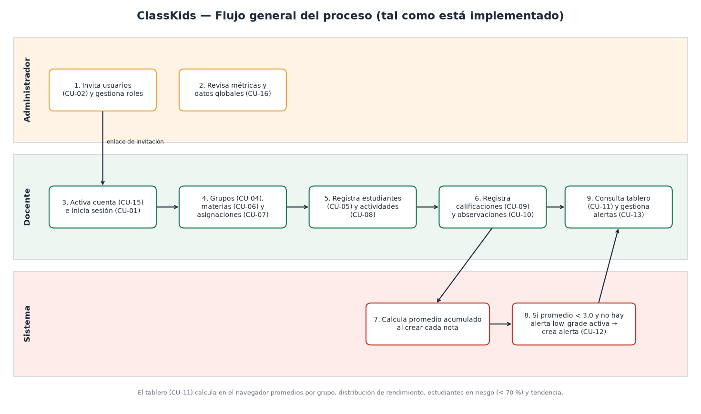
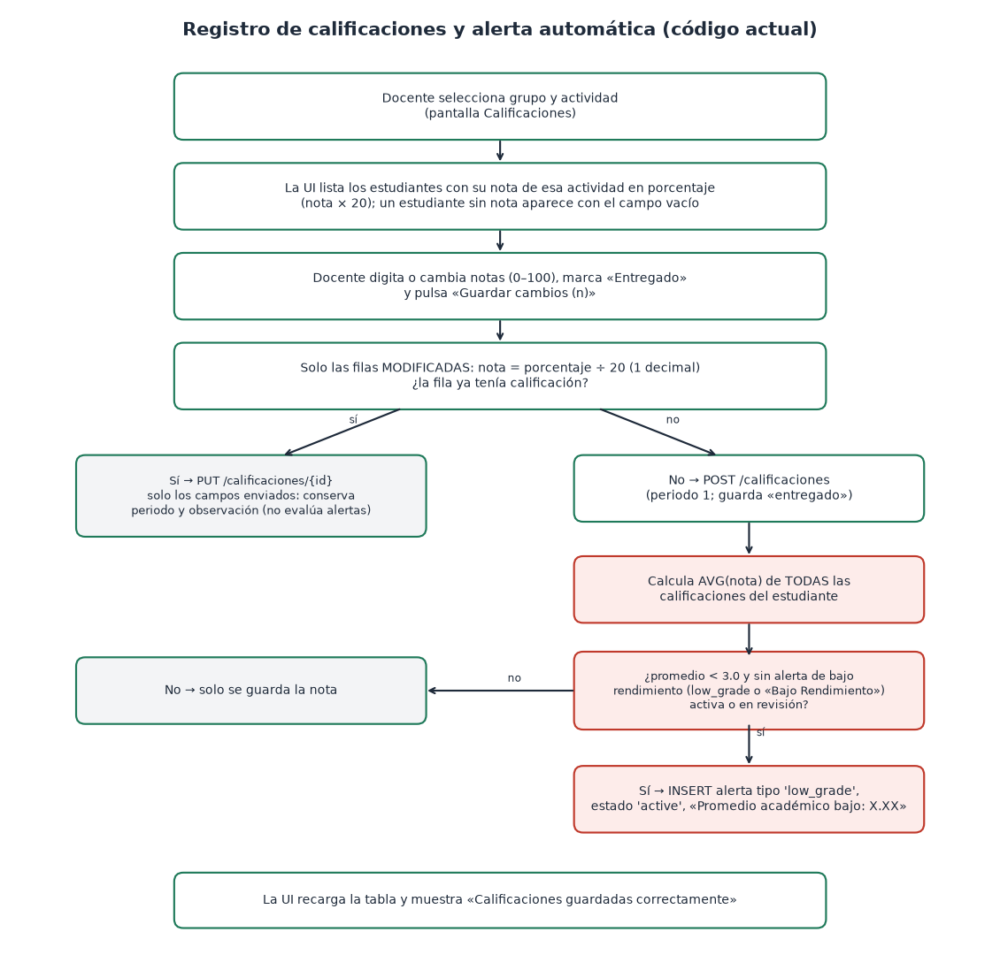

# Flujos del sistema

Este capítulo actualiza el «Flujo del proceso del sistema» del documento original con el funcionamiento real de cada etapa.

## Flujo general del proceso

### 1. Incorporación de usuarios

El proceso inicia con el administrador. Desde Panel Admin → Usuarios invita a cada docente indicando su correo y su rol. El sistema crea una invitación con vigencia de 48 horas y, si hay servidor de correo configurado, envía el enlace; además muestra el enlace en pantalla para copiarlo. La persona invitada abre el enlace, escribe sus nombres, apellidos y contraseña, y su cuenta queda activa. No existe registro público.

### 2. Acceso y autenticación

El usuario ingresa su correo y contraseña. El backend verifica que exista, que esté activo y que la contraseña coincida con el hash almacenado, y emite un token JWT con vigencia de 8 horas que incluye el rol. El frontend guarda el token y muestra las opciones según el rol: el docente accede a los módulos académicos y el administrador, además, al Panel Admin. Si olvida la contraseña, puede solicitar un enlace de recuperación válido por 30 minutos.

### 3. Estructura académica

Se registran los grupos (cursos de 1.° a 5.°, secciones A y B, con su turno), el catálogo de materias y las asignaciones, que definen qué docente dicta cada materia en cada grupo. Ejemplo con los datos demo:

| Grupo | Materia | Docente asignado |
|---|---|---|
| Grado 4A | Matemáticas | Laura Jiménez |
| Grado 4A | Español y Literatura | Carlos Peña |
| Grado 4A | Ciencias Naturales | Marcela Ospina |
| Grado 4A | Sociales | Andrés Beltrán |
| Grado 4A | Inglés | Paula Restrepo |

Cada materia tiene un solo docente por grupo. En la versión actual las asignaciones son informativas: no restringen qué grupos puede ver o modificar cada docente.

### 4. Registro de estudiantes

Cada estudiante se registra con su documento (único), nombres, apellidos y grupo. Desde el listado se puede buscar, filtrar por grupo o por estado, y abrir el detalle del estudiante.

### 5. Creación de actividades

El docente crea las actividades (tarea, examen, proyecto o participación) indicando título, grupo, materia, fecha de entrega y descripción. El sistema calcula su estado: pendiente, vencida (fecha pasada) o completada (todos los estudiantes del grupo calificados).

### 6. Registro de calificaciones

El docente elige un grupo y una actividad, escribe o cambia las notas de 0.0 a 5.0, marca las entregas y guarda. Solo se guardan las filas modificadas; los estudiantes sin nota no reciben un 0 y, al editar, se conservan la observación y el periodo de cada calificación. Cada nota se almacena tal como se escribió, con un decimal, en la escala académica oficial de 0.0 a 5.0, asociada al estudiante, la materia y la actividad. Así se construye el historial académico del estudiante. Las pantallas de consulta la muestran en la misma escala, con el porcentaje como dato secundario.

### 7. Cálculo y análisis del rendimiento

Con las calificaciones registradas, la interfaz calcula los promedios por estudiante, grupo, materia y tipo de actividad, clasifica el rendimiento (Excelente, Bueno, Regular, En riesgo), determina la tendencia entre periodos e identifica a los estudiantes en riesgo (promedio menor a 3.5, que se muestra como 70 %) y críticos (menor a 3.0, 60 %).

### 8. Generación automática de alertas

Cada vez que se crea una calificación, el backend calcula el promedio acumulado del estudiante. Si es menor a 3.0 y no tiene ya una alerta de bajo rendimiento activa o en revisión (de tipo `low_grade` o «Bajo Rendimiento»), registra una alerta automáticamente. Las alertas aparecen en el Dashboard, en la pantalla Alertas y en el detalle del estudiante. En la versión actual no existen reglas de inasistencia, comportamiento o deserción.

### 9. Observaciones y seguimiento cualitativo

Desde el detalle del estudiante, el docente registra observaciones de tipo Académica, Convivencial o Reconocimiento, con fecha y hora automáticas. Complementan la información cuantitativa de las notas.

### 10. Gestión de alertas

El docente revisa las alertas, las filtra por tipo y estado, y registra su avance marcándolas como «En revisión» o «Resueltas». El panel del Dashboard muestra solo las activas; las resueltas se conservan y se consultan con el filtro «Resueltas» de la pantalla Alertas.

### 11. Consulta de información

El docente consulta el Dashboard (resumen al ingresar) y la pantalla Análisis (gráficas e indicadores). El administrador consulta las métricas globales y los datos de toda la plataforma.

### 12. Cierre de sesión

El usuario cierra sesión desde la barra lateral; el token se elimina del navegador.

## Flujo detallado: registro de calificaciones y alerta automática

## Flujo detallado: incorporación de un docente

| Paso | Actor | Acción | Componente |
|---|---|---|---|
| 1 | Administrador | Pulsa «Invitar docente», ingresa correo y rol, y pulsa «Enviar invitación». | `AdminUsuarios.tsx` → `POST /usuarios/invitar` |
| 2 | Sistema | Crea la invitación (token único, 48 h) y envía el correo si hay SMTP. Devuelve el enlace. | `invitaciones` |
| 3 | Usuario invitado | Abre `/invitacion?token=…`. | `Invitation.tsx` → `GET /invitaciones/{token}` |
| 4 | Usuario invitado | Ingresa nombres, apellidos y contraseña y confirma. | `POST /invitaciones/{token}/aceptar` |
| 5 | Sistema | Crea el usuario con la contraseña cifrada y marca la invitación como aceptada. | `usuarios`, `invitaciones` |
| 6 | Docente | Inicia sesión con su correo y contraseña. | CU-01 |

## Flujo detallado: recuperación de contraseña

| Paso | Actor | Acción | Componente |
|---|---|---|---|
| 1 | Usuario | En el login pulsa «¿Olvidaste tu contraseña?», escribe su correo y pulsa «Enviar enlace». | `Auth.tsx` → `POST /auth/forgot-password` |
| 2 | Sistema | Si el usuario existe y está activo, crea un token de 30 minutos y envía el enlace. Responde siempre con un mensaje genérico. | `password_reset_tokens` |
| 3 | Usuario | Abre el enlace, escribe y confirma la nueva contraseña. | `ResetPassword.tsx` → `POST /auth/reset-password` |
| 4 | Sistema | Actualiza la contraseña y marca el token como usado. | `usuarios` |
