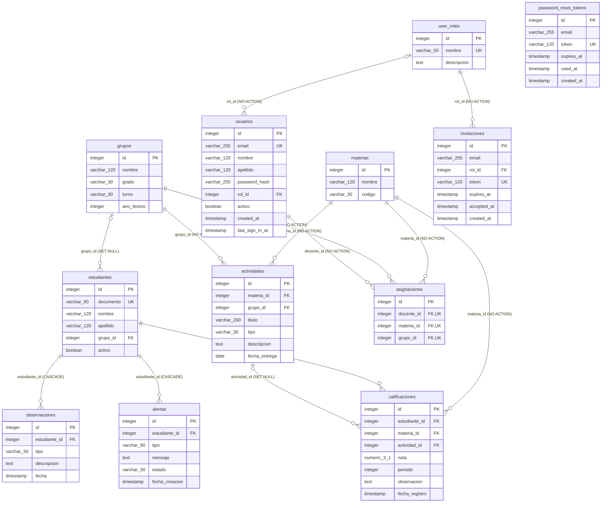

# Modelo relacional verificado (base real)

Verificado el **2026-11-23** con consultas de **solo lectura** sobre la base real `classkids` (contenedor `classkids_db`, puerto 5432), mediante [`verificacion-mr.sql`](../evidencias/scripts/verificacion-mr.sql). La salida completa está en [`verificacion-mr-real.txt`](../evidencias/verificacion-mr-real.txt). Este documento se genera con [`generar-modelo-relacional.py`](../evidencias/scripts/generar-modelo-relacional.py), así que no se edita a mano.

> **Columna `entregado`:** NO existe en la base real. La migración 001, que la agrega, sigue **pendiente de autorización** y solo está aplicada en la base de pruebas `classkids_test`. Por eso no aparece en este modelo.

Versiones del diagrama: editable (Mermaid, abajo) · [PNG](../diagramas/modelo-relacional.png) · [PDF](../diagramas/modelo-relacional.pdf).

## 1. Diagrama

Cardinalidad: `||--o{` es «uno a muchos, obligatorio» (la FK no admite nulos) y `|o--o{` es «cero o uno a muchos» (la FK admite nulos). Entre paréntesis va la acción `ON DELETE`.

## 2. Llaves foráneas y acciones ON DELETE

| Tabla.columna | Referencia | Admite nulo | ON DELETE | Qué significa |
|---|---|---|---|---|
| `actividades.grupo_id` | `grupos.id` | No | NO ACTION | No se puede borrar el registro padre mientras tenga registros relacionados |
| `actividades.materia_id` | `materias.id` | No | NO ACTION | No se puede borrar el registro padre mientras tenga registros relacionados |
| `alertas.estudiante_id` | `estudiantes.id` | No | CASCADE | Al borrar el registro padre se borran también estos registros |
| `asignaciones.docente_id` | `usuarios.id` | No | NO ACTION | No se puede borrar el registro padre mientras tenga registros relacionados |
| `asignaciones.grupo_id` | `grupos.id` | No | NO ACTION | No se puede borrar el registro padre mientras tenga registros relacionados |
| `asignaciones.materia_id` | `materias.id` | No | NO ACTION | No se puede borrar el registro padre mientras tenga registros relacionados |
| `calificaciones.actividad_id` | `actividades.id` | Sí | SET NULL | Al borrar el registro padre, este campo queda vacío y el registro se conserva |
| `calificaciones.estudiante_id` | `estudiantes.id` | No | CASCADE | Al borrar el registro padre se borran también estos registros |
| `calificaciones.materia_id` | `materias.id` | No | NO ACTION | No se puede borrar el registro padre mientras tenga registros relacionados |
| `estudiantes.grupo_id` | `grupos.id` | Sí | SET NULL | Al borrar el registro padre, este campo queda vacío y el registro se conserva |
| `invitaciones.rol_id` | `user_roles.id` | No | NO ACTION | No se puede borrar el registro padre mientras tenga registros relacionados |
| `observaciones.estudiante_id` | `estudiantes.id` | No | CASCADE | Al borrar el registro padre se borran también estos registros |
| `usuarios.rol_id` | `user_roles.id` | Sí | NO ACTION | No se puede borrar el registro padre mientras tenga registros relacionados |

## 3. Restricciones (PK, UNIQUE, CHECK)

| Tabla | Restricción | Tipo | Definición |
|---|---|---|---|
| `user_roles` | `user_roles_pkey` | PRIMARY KEY | `PRIMARY KEY (id)` |
| `user_roles` | `user_roles_nombre_key` | UNIQUE | `UNIQUE (nombre)` |
| `usuarios` | `usuarios_pkey` | PRIMARY KEY | `PRIMARY KEY (id)` |
| `usuarios` | `usuarios_email_key` | UNIQUE | `UNIQUE (email)` |
| `invitaciones` | `invitaciones_pkey` | PRIMARY KEY | `PRIMARY KEY (id)` |
| `invitaciones` | `invitaciones_token_key` | UNIQUE | `UNIQUE (token)` |
| `password_reset_tokens` | `password_reset_tokens_pkey` | PRIMARY KEY | `PRIMARY KEY (id)` |
| `password_reset_tokens` | `password_reset_tokens_token_key` | UNIQUE | `UNIQUE (token)` |
| `grupos` | `grupos_pkey` | PRIMARY KEY | `PRIMARY KEY (id)` |
| `estudiantes` | `estudiantes_pkey` | PRIMARY KEY | `PRIMARY KEY (id)` |
| `estudiantes` | `estudiantes_documento_key` | UNIQUE | `UNIQUE (documento)` |
| `materias` | `materias_pkey` | PRIMARY KEY | `PRIMARY KEY (id)` |
| `actividades` | `actividades_pkey` | PRIMARY KEY | `PRIMARY KEY (id)` |
| `calificaciones` | `calificaciones_nota_check` | CHECK | `CHECK (((nota >= (0)::numeric) AND (nota <= (5)::numeric)))` |
| `calificaciones` | `calificaciones_pkey` | PRIMARY KEY | `PRIMARY KEY (id)` |
| `observaciones` | `observaciones_pkey` | PRIMARY KEY | `PRIMARY KEY (id)` |
| `alertas` | `alertas_pkey` | PRIMARY KEY | `PRIMARY KEY (id)` |
| `asignaciones` | `asignaciones_pkey` | PRIMARY KEY | `PRIMARY KEY (id)` |
| `asignaciones` | `asignaciones_docente_id_materia_id_grupo_id_key` | UNIQUE | `UNIQUE (docente_id, materia_id, grupo_id)` |

## 4. Índices

| Tabla | Índice | Definición |
|---|---|---|
| `actividades` | `actividades_pkey` | `UNIQUE actividades_pkey ON public.actividades (id)` |
| `alertas` | `alertas_pkey` | `UNIQUE alertas_pkey ON public.alertas (id)` |
| `asignaciones` | `asignaciones_docente_id_materia_id_grupo_id_key` | `UNIQUE asignaciones_docente_id_materia_id_grupo_id_key ON public.asignaciones (docente_id, materia_id, grupo_id)` |
| `asignaciones` | `asignaciones_docente_materia_grupo_uidx` | `UNIQUE asignaciones_docente_materia_grupo_uidx ON public.asignaciones (docente_id, materia_id, grupo_id)` |
| `asignaciones` | `asignaciones_materia_grupo_uidx` | `UNIQUE asignaciones_materia_grupo_uidx ON public.asignaciones (materia_id, grupo_id)` |
| `asignaciones` | `asignaciones_pkey` | `UNIQUE asignaciones_pkey ON public.asignaciones (id)` |
| `calificaciones` | `calificaciones_pkey` | `UNIQUE calificaciones_pkey ON public.calificaciones (id)` |
| `estudiantes` | `estudiantes_documento_key` | `UNIQUE estudiantes_documento_key ON public.estudiantes (documento)` |
| `estudiantes` | `estudiantes_pkey` | `UNIQUE estudiantes_pkey ON public.estudiantes (id)` |
| `grupos` | `grupos_pkey` | `UNIQUE grupos_pkey ON public.grupos (id)` |
| `invitaciones` | `invitaciones_pkey` | `UNIQUE invitaciones_pkey ON public.invitaciones (id)` |
| `invitaciones` | `invitaciones_token_key` | `UNIQUE invitaciones_token_key ON public.invitaciones (token)` |
| `materias` | `materias_pkey` | `UNIQUE materias_pkey ON public.materias (id)` |
| `observaciones` | `observaciones_pkey` | `UNIQUE observaciones_pkey ON public.observaciones (id)` |
| `password_reset_tokens` | `password_reset_tokens_pkey` | `UNIQUE password_reset_tokens_pkey ON public.password_reset_tokens (id)` |
| `password_reset_tokens` | `password_reset_tokens_token_key` | `UNIQUE password_reset_tokens_token_key ON public.password_reset_tokens (token)` |
| `user_roles` | `user_roles_nombre_key` | `UNIQUE user_roles_nombre_key ON public.user_roles (nombre)` |
| `user_roles` | `user_roles_pkey` | `UNIQUE user_roles_pkey ON public.user_roles (id)` |
| `usuarios` | `usuarios_email_key` | `UNIQUE usuarios_email_key ON public.usuarios (email)` |
| `usuarios` | `usuarios_pkey` | `UNIQUE usuarios_pkey ON public.usuarios (id)` |

## 5. Diccionario de datos

### `actividades`

| # | Columna | Tipo | Nulo | Por defecto | Clave |
|---:|---|---|---|---|---|
| 1 | `id` | integer | No | autoincremental | PK |
| 2 | `materia_id` | integer | No |  | FK → `materias.id` |
| 3 | `grupo_id` | integer | No |  | FK → `grupos.id` |
| 4 | `titulo` | varchar(200) | No |  |  |
| 5 | `tipo` | varchar(30) | No | tarea |  |
| 6 | `descripcion` | text | Sí |  |  |
| 7 | `fecha_entrega` | date | Sí |  |  |

### `alertas`

| # | Columna | Tipo | Nulo | Por defecto | Clave |
|---:|---|---|---|---|---|
| 1 | `id` | integer | No | autoincremental | PK |
| 2 | `estudiante_id` | integer | No |  | FK → `estudiantes.id` |
| 3 | `tipo` | varchar(80) | No |  |  |
| 4 | `mensaje` | text | No |  |  |
| 5 | `estado` | varchar(30) | No | active |  |
| 6 | `fecha_creacion` | timestamp without time zone | No | CURRENT_TIMESTAMP |  |

### `asignaciones`

| # | Columna | Tipo | Nulo | Por defecto | Clave |
|---:|---|---|---|---|---|
| 1 | `id` | integer | No | autoincremental | PK |
| 2 | `docente_id` | integer | No |  | UK · FK → `usuarios.id` |
| 3 | `materia_id` | integer | No |  | UK · FK → `materias.id` |
| 4 | `grupo_id` | integer | No |  | UK · FK → `grupos.id` |

### `calificaciones`

| # | Columna | Tipo | Nulo | Por defecto | Clave |
|---:|---|---|---|---|---|
| 1 | `id` | integer | No | autoincremental | PK |
| 2 | `estudiante_id` | integer | No |  | FK → `estudiantes.id` |
| 3 | `materia_id` | integer | No |  | FK → `materias.id` |
| 4 | `actividad_id` | integer | Sí |  | FK → `actividades.id` |
| 5 | `nota` | numeric(3,1) | No |  |  |
| 6 | `periodo` | integer | No | 1 |  |
| 7 | `observacion` | text | Sí |  |  |
| 8 | `fecha_registro` | timestamp without time zone | No | CURRENT_TIMESTAMP |  |

### `estudiantes`

| # | Columna | Tipo | Nulo | Por defecto | Clave |
|---:|---|---|---|---|---|
| 1 | `id` | integer | No | autoincremental | PK |
| 2 | `documento` | varchar(50) | No |  | UK |
| 3 | `nombre` | varchar(120) | No |  |  |
| 4 | `apellido` | varchar(120) | No |  |  |
| 5 | `grupo_id` | integer | Sí |  | FK → `grupos.id` |
| 6 | `activo` | boolean | No | true |  |

### `grupos`

| # | Columna | Tipo | Nulo | Por defecto | Clave |
|---:|---|---|---|---|---|
| 1 | `id` | integer | No | autoincremental | PK |
| 2 | `nombre` | varchar(120) | No |  |  |
| 3 | `grado` | varchar(30) | Sí |  |  |
| 4 | `turno` | varchar(30) | Sí |  |  |
| 5 | `ano_lectivo` | integer | Sí | 2026 |  |

### `invitaciones`

| # | Columna | Tipo | Nulo | Por defecto | Clave |
|---:|---|---|---|---|---|
| 1 | `id` | integer | No | autoincremental | PK |
| 2 | `email` | varchar(255) | No |  |  |
| 3 | `rol_id` | integer | No |  | FK → `user_roles.id` |
| 4 | `token` | varchar(120) | No |  | UK |
| 5 | `expires_at` | timestamp without time zone | No |  |  |
| 6 | `accepted_at` | timestamp without time zone | Sí |  |  |
| 7 | `created_at` | timestamp without time zone | No | CURRENT_TIMESTAMP |  |

### `materias`

| # | Columna | Tipo | Nulo | Por defecto | Clave |
|---:|---|---|---|---|---|
| 1 | `id` | integer | No | autoincremental | PK |
| 2 | `nombre` | varchar(120) | No |  |  |
| 3 | `codigo` | varchar(30) | Sí |  |  |

### `observaciones`

| # | Columna | Tipo | Nulo | Por defecto | Clave |
|---:|---|---|---|---|---|
| 1 | `id` | integer | No | autoincremental | PK |
| 2 | `estudiante_id` | integer | No |  | FK → `estudiantes.id` |
| 3 | `tipo` | varchar(50) | Sí | Convivencial |  |
| 4 | `descripcion` | text | No |  |  |
| 5 | `fecha` | timestamp without time zone | No | CURRENT_TIMESTAMP |  |

### `password_reset_tokens`

| # | Columna | Tipo | Nulo | Por defecto | Clave |
|---:|---|---|---|---|---|
| 1 | `id` | integer | No | autoincremental | PK |
| 2 | `email` | varchar(255) | No |  |  |
| 3 | `token` | varchar(120) | No |  | UK |
| 4 | `expires_at` | timestamp without time zone | No |  |  |
| 5 | `used_at` | timestamp without time zone | Sí |  |  |
| 6 | `created_at` | timestamp without time zone | No | CURRENT_TIMESTAMP |  |

### `user_roles`

| # | Columna | Tipo | Nulo | Por defecto | Clave |
|---:|---|---|---|---|---|
| 1 | `id` | integer | No | autoincremental | PK |
| 2 | `nombre` | varchar(50) | No |  | UK |
| 3 | `descripcion` | text | Sí |  |  |

### `usuarios`

| # | Columna | Tipo | Nulo | Por defecto | Clave |
|---:|---|---|---|---|---|
| 1 | `id` | integer | No | autoincremental | PK |
| 2 | `email` | varchar(255) | No |  | UK |
| 3 | `nombre` | varchar(120) | No |  |  |
| 4 | `apellido` | varchar(120) | Sí |  |  |
| 5 | `password_hash` | varchar(255) | No |  |  |
| 6 | `rol_id` | integer | Sí |  | FK → `user_roles.id` |
| 7 | `activo` | boolean | No | true |  |
| 8 | `created_at` | timestamp without time zone | No | CURRENT_TIMESTAMP |  |
| 9 | `last_sign_in_at` | timestamp without time zone | Sí |  |  |

## 6. Puntos revisados

| Punto | Resultado |
|---|---|
| calificaciones.actividad_id admite nulos | YES |
| password_reset_tokens tiene FK hacia usuarios | no |
| calificaciones.entregado existe | no |
| tablas en public | 12 |
